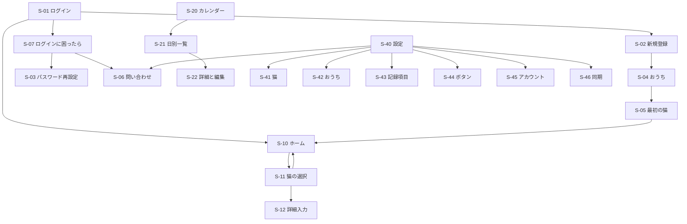

# 画面設計書：MeowScope

| 項目 | 内容 |
|---|---|
| 文書番号 | 04 |
| 版数 | 0.31 |
| 作成日 | 2026-11-02 |
| 作成者 | major182 |
| 前提となる文書 | [01 要件定義書](01_requirements.md) |

---

## 1. 全体の方針

- アプリを開いた最初の画面はホームとする
- 記録は「項目を選ぶ → おうちの猫を選ぶ → 保存」の流れとする。猫が1匹のときは猫の選択を省く
- 記録は即座に保存し、保存の後に「詳細を追加」を数秒表示する。詳細の入力は任意で、後からでも追加できる
- カレンダーと統計は、画面上部で全員または1匹に絞り込む。統計は1匹の表示を基本とする
- ホームには同期の状態を小さなアイコンと最終同期時刻で示す。押すと手動で同期し、未送信の件数は S-46 で確認する
- 猫とユーザーは、名前が出る場面では「アイコン＋名前」で表示する
- 記録項目のアイコンはイラストとする。ホームのボタンは猫の入ったイラスト、カレンダーは小さくても見分けられる専用のイラスト（道具などを切り出したもの）を別に用意する。メモの印もイラストを用意する
- アプリのアイコンは `mainicon_01` を基本とする。端末によってアイコンの形が丸と四角に分かれるため、`mainicon_02` も用意している
- メールアドレスとパスワードの入力欄は全角を受け付けない。コピーと貼り付けは許可するが、全角が混ざった内容は貼り付け自体を受け付けず、入力欄を変えないまま案内を表示する
- 削除の確認では、誤操作を防ぐためボタンの位置を通常と入れ替え、左に実行、右にキャンセルを置く（BR-29）
- ダイアログの見出しなどの短い文は、折り返すときに言葉の切れ目（助詞や記号の後ろ）で切り、行の長さをそろえる。1文字だけが次の行に回ったり、言葉の途中で切れたりしないようにする
- 選択のボタン（性別・週の始まり・量など）は、選んだものに ✓ を出してそろえる
- Android の下部メニューは、ホーム、カレンダー、統計、設定の4つとする
- Windows は幅に合わせて左にメニューを置き、カレンダーと日別一覧を並べて表示する
- 広い幅（900px 以上）では、ホームの記録のボタンの幅を 160px までにし、窓が広いほど列を増やす。入力欄とボタンが中心の画面は、中身の幅を 640px までにして中央に寄せる（NF-UX-02）

## 2. 画面一覧

| ID | 画面 | 関連する要件 |
|---|---|---|
| S-01 | ログイン | F-AU-01 |
| S-02 | 新規登録 | F-AU-01 |
| S-03 | パスワード再設定 | F-AU-03 |
| S-04 | おうちの作成または参加 | F-SH-02、F-SH-04、BR-21 |
| S-05 | 最初の猫の登録 | F-SH-01、F-SH-05 |
| S-06 | ログの書き出しと問い合わせの案内 | F-LG-04 |
| S-07 | ログインに困ったら | F-AU-03、F-LG-04 |
| S-10 | ホーム | F-RC-01 |
| S-11 | 猫の選択 | BR-23 |
| S-12 | 記録の詳細入力 | F-RC-02、F-RC-03、F-RC-04 |
| S-20 | カレンダー | F-VW-01 |
| S-21 | 日別一覧 | F-VW-02 |
| S-22 | 記録の詳細と編集 | F-VW-02 |
| S-30 | 統計 | F-ST-01 |
| S-40 | 設定 | - |
| S-41 | 猫の一覧とプロフィール | F-SH-05、F-SH-06、F-SH-07、F-SH-08 |
| S-42 | おうちの管理 | F-SH-03、F-SH-04、BR-19 |
| S-43 | 記録項目の設定 | F-RC-05、BR-22 |
| S-44 | ウィジェットのボタン設定（Android） | F-WG-01、BR-22 |
| S-45 | アカウント設定 | F-AU-02、BR-16 |
| S-46 | 同期の状態 | F-OF-03 |
| S-47 | しきい値の設定 | BR-20 |

## 3. 画面遷移



## 4. ホーム（S-10）

```text
おうち名            11/02  同期済み
+-----+-----+-----+-----+
| ご飯 |  水  |  薬  | 尿  |
+-----+-----+-----+-----+
| 便  | 吐いた| 体重 |ブラシ|
+-----+-----+-----+-----+
|  ＋  |
+-----+
今日の記録
 08:10 (猫)ミケ ご飯
 09:30 (猫)タマ おしっこ
------------------------
ホーム カレンダー 統計 設定
```

## 5. その他の画面のイメージ

### S-01 ログイン

```text
MeowScope
------------------------
メールアドレス
+----------------------+
|                      |
+----------------------+
パスワード
+----------------------+
|                      |
+----------------------+
+----------------------+
|      ログイン        |
+----------------------+
------------------------
新規アカウント作成
ログインに困ったら
```

### S-02 新規登録

```text
< 新規アカウント作成
------------------------
名前（記録に投稿者として表示）
メールアドレス
パスワード（8〜64文字）
+----------------------+
|       登録する       |
+----------------------+
```

- 名前は20文字まで。メールアドレスとパスワードは半角だけ（BR-26）
- 登録できたら S-04 へ進む。登録済みのメールアドレスはその旨を出す
- ログインの失敗は、メールアドレスとパスワードのどちらが違うかを区別せずに出す。続けて失敗したら、しばらく待つよう案内する（NF-SC-03）。サーバーの異常のときだけ問い合わせ番号を出す（F-LG-02）

### S-07 ログインに困ったら

```text
< ログインに困ったら
------------------------
+----------------------+
|   パスワード再発行   |
+----------------------+
+----------------------+
|      問い合わせ      |
+----------------------+
```

「パスワード再発行」はメール送信の手段が決まるまで（Q-26）「準備中」とし、押せないようにする。「問い合わせ」は S-06 を開く。

### S-04 おうちの作成または参加

```text
おうちを準備します
------------------------
+----------------------+
|  新しいおうちを作る  |
+----------------------+
おうちの名前
+----------------------+
|                      |
+----------------------+
+----------------------+
| 招待されたおうちに参加|
+----------------------+
```

おうちを作った人はログイン中のユーザーで、記録の投稿者名には新規登録（S-02）で入れた名前を使う（BR-17）。「招待されたおうちに参加」では、LINE などで届いた招待の文をそのまま貼り付けて参加する。Android は招待のリンクを押すとアプリが開き、この画面にトークンが入った状態で出る。

認証の実装の前に端末で作ったデータ（仮の利用者・おうち・猫・記録）は試しのデータとして扱い、アカウントへは引き継がない。認証の実装で端末の DB から消し、ログインの後に S-04 から作り直す。

### S-05 最初の猫の登録

```text
猫を登録しましょう
------------------------
名前
+----------------------+
|                      |
+----------------------+
以下は任意です
+------+  生年月日
| 写真 |  +------------+
+------+  |            |
          +------------+
性別
+------+------+------+
|男の子|女の子| 不明 |
+------+------+------+
持病
+----------------------+
|                      |
+----------------------+
+----------------------+
|       登録する       |
+----------------------+
```

### S-06 ログの書き出しと問い合わせの案内

```text
< 問い合わせ
------------------------
不具合があったときは、ログを保存して
次の宛先へ添付して連絡してください
問い合わせ先：<問い合わせ先の Gmail>
+----------------------+
|    ログを保存する    |
+----------------------+
+----------------------+
|  宛先をコピーする    |
+----------------------+
```

- 問い合わせ先はビルドのときに設定で渡し（リポジトリには書かない）、設定がなければその旨を出して「宛先をコピーする」を押せないようにする
- 「ログを保存する」で保存した場所を出す。保存できないときは「ログをコピーする」を案内する

### S-11 猫の選択

```text
ご飯：どの子ですか？
------------------------
+----------+----------+
| (猫)ミケ | (猫)タマ |
+----------+----------+
------------------------
キャンセル
```

### S-10 保存の後

```text
------------------------
保存しました
+------------+
| 詳細を追加 |   数秒で消える
+------------+
------------------------
ホーム カレンダー 統計 設定
```

### S-12 記録の詳細入力（ご飯の例）

```text
< ご飯            [保存]
------------------------
猫    (猫)ミケ
日時
+----------------------+
| 11/02 08:10          |
+----------------------+
以下は任意です
量
+------+------+------+
| 少し | 普通 | 多い |
+------+------+------+
+------+
| 写真 |
+------+
メモ
+----------------------+
|                      |
+----------------------+
```

項目ごとの入力欄は次のとおりとする。

| 入力欄 | 対象の項目 | 決まり |
|---|---|---|
| 日時 | すべて | 未来は選べない |
| 量（少し・普通・多い） | ご飯・水・おしっこ・うんち・吐いた・独自の項目 | 選んだものをもう一度押すと取り消す |
| 体重 | 体重 | 0.1〜30 kg |
| メモ | すべて | 1000文字まで。前後の空白を除き、空白だけなら空とする |

写真は3枚まで付けられ、3枚あれば追加のボタンを押せない（AC-03）。写真はその場で保存し、「保存」を押さなくても付く。Android はカメラかアルバム、Windows はファイルから選ぶ。記録の詳細（S-22）では写真を並べ、端末になくオフラインのときは「オンラインで表示できます」と出す（BR-28）。

### S-20 カレンダー

```text
[全員 v]   < 2026年11月 >
 日  月  火  水  木  金  土
+---+---+---+---+---+---+---+
| 1 | 2 | 3 | 4 | 5 | 6 | 7 |
|食尿|食水|   |   |   |   |   |
|便 |吐メ|   |   |   |   |   |
+---+---+---+---+---+---+---+
| 8 | 9 |10 |11 |12 |13 |14 |
|   |   |   |   |   |   |   |
+---+---+---+---+---+---+---+
  ...（6行）
------------------------
ホーム カレンダー 統計 設定
```

- セルには、その日の記録の項目のイラストを標準の項目の順に1つずつ並べ、メモがあれば最後にメモのイラストを付ける。独自の項目は標準の後ろに並べる
- 標準の項目はカレンダー用のイラスト（`cal_*`）、独自の項目は選んだイラストを使う。メモは `cal_memo`
- 前月と翌月の日は薄く表示する。今日は太字にする
- 狭い幅では、日を押すと日別一覧（S-21）を開き、絞り込みを引き継ぐ。広い幅（900px 以上）では、日別一覧を右に並べ、押した日に切り替える

### S-21 日別一覧

「<」「>」で前後の日へ移動する。記録は時刻の古い順に並べる。

```text
戻る    < 11月 2日 >
------------------------
+----------------------+
| 08:10 (猫)ミケ ご飯 [メ]|
+----------------------+
| 09:30 (猫)タマ おしっこ|
+----------------------+
| 12:00 (猫)ミケ 吐いた[写]|
+----------------------+
```

### S-22 記録の詳細と編集

```text
< 記録の詳細  [編集][削除]
------------------------
(猫) ミケ   吐いた
11/02 12:00   投稿者：(人)○○
量    少し
+----------------------+
|        写真          |
+----------------------+
メモ  毛玉のよう
```

入力していない詳細は表示しない（詳細が1つもなくても、その旨の文は出さない）。削除の確認は BR-29 に従う。

### S-30 統計

```text
[ミケ v]        +---+---+
                | 週| 月|
                +---+---+
体重 (kg)
4.2 |      ._._.
4.0 |__.__/
------------------------
回数の推移  [ご飯 v]
3 | #  #  #  #
2 | #  #  #  #  #  #
------------------------
ホーム カレンダー 統計 設定
```

- 1匹を選んで表示する。最初は登録順で先頭の猫とし、お別れの猫も選べる
- 「週」は今日までの7日、「月」は今日までの30日を日ごとに表示する
- 体重は、数値を入力した体重の記録を折れ線で結ぶ。記録がなければその旨を表示する
- 回数の推移は、選んだ項目の日ごとの回数を棒で表示する。体重は項目の選択に出さない

### S-40 設定

```text
設定
------------------------
+----------------------+
| 猫の一覧とプロフィール>|
+----------------------+
| おうちの管理        > |
+----------------------+
| 記録項目の設定      > |
+----------------------+
| ウィジェットのボタン > |  Android のみ
+----------------------+
| アカウント          > |
+----------------------+
| 同期の状態          > |
+----------------------+
| 問い合わせ          > |
+----------------------+
| カレンダーの週の始まり|
| 日曜 / 月曜（既定は日曜）|
+----------------------+
------------------------
ホーム カレンダー 統計 設定
```

- 週の始まりは押すとすぐに保存し、カレンダーに反映する
- まだ作っていない画面の項目（ウィジェットのボタン）は、作るまで「準備中」と表示し、押せないようにする

### S-41 猫の一覧とプロフィール

```text
< 猫              [追加]
------------------------
+----------------------+
| (猫) ミケ  3歳      > |
+----------------------+
| (猫) タマ  5歳      > |
+----------------------+
| (猫) ソラ  お別れ   > |
+----------------------+
```

- 一覧には登録順に、年齢（1歳以上は「N歳」、1歳未満は「Nか月」。生年月日がなければ空）またはお別れを表示する
- 猫を押すとプロフィールを開く。項目は S-05 と同じで、「保存する」で一覧へ戻る
- プロフィールの下に「お別れにする」（お別れの猫は「お別れを取り消す」）と「削除する」を置く。お別れの猫は記録の対象から外れ、記録は残る（BR-25）
- 削除は確認の後に行い、その猫と記録を消す。確認では、記録を残すときはお別れを使うよう案内する（BR-27、BR-29）

### S-42 おうちの管理

```text
< おうちの管理
------------------------
おうち名
+----------------------+
|                      |
+----------------------+
メンバー  (人)○○ / (人)△△
+----------------------+
|   メールで招待する   |
+----------------------+
+----------------------+
|    おうちを抜ける    |
+----------------------+
```

- おうち名は「保存」で同期待ちに入れる（オフラインでも変えられる）
- メンバーは同期で受け取った今のメンバー
- 「リンクで招待する」で招待の文（おうちの名前、リンク、開けないときの案内）を作ってコピーし、LINE などで送ってもらう。リンクは60分・1回だけ使える
- 「メールで招待する」はメール送信の手段が決まるまで（Q-26）「準備中」
- おうちを抜けるときは記録を残すか消すかを選ぶ。最後の1人のときは、おうちと記録がすべて消える旨の削除の確認を出す（BR-19）。抜けたらおうちの作成（S-04）へ戻る。通信が要る

### S-43 記録項目の設定

```text
< 記録項目        [追加]
------------------------
+----------------------+
| ご飯（標準）         |
+----------------------+
| ブラシ（標準）       |
+----------------------+
| 通院   [編集][非表示]|
+----------------------+
```

独自の項目の追加と編集では、名前を入力し、アイコンをアプリが用意したイラストの一覧から選ぶ（F-RC-05）。

- 名前は必須で20文字まで。同じおうちの他の項目と同じ名前は使えない
- 独自の項目は標準の項目の後ろに、追加した順に並べる。ホームのボタンにも同じ順で並ぶ
- 標準の項目は名前もアイコンも変えられず、非表示にもできない
- 独自の項目は削除できず、非表示にできる。非表示の項目には「非表示中」と出す。ホームのボタンと統計の項目の選択には出さず、過去の記録はカレンダー・日別一覧・詳細にそのまま出る。「表示に戻す」で戻せる
- 非表示の項目と同じ名前の項目は追加できない
- アイコンは、通院・遊び・爪切り・歯みがき・おやつ・その他のイラストから選ぶ。イラストが見つからない値は「その他」で表示する

### S-44 ウィジェットのボタン設定

```text
< ウィジェットのボタン
------------------------
+----------------------+
| ご飯           [削除]|
+----------------------+
| 薬             [削除]|
+----------------------+
+----------------------+
|    ボタンを追加      |
+----------------------+
```

### S-45 アカウント設定

```text
< アカウント
------------------------
+------+
| (人) |  アイコン
+------+
名前
+----------------------+
|                      |
+----------------------+
+----------------------+
|  パスワードを変更    |
+----------------------+
+----------------------+
|     ログアウト       |
+----------------------+
+----------------------+
|  アカウントを削除    |
+----------------------+
```

- 名前は「保存」で送る。これからの記録の投稿者名になり、過去の記録の投稿者名は変えない（BR-17）
- パスワードの変更は、今のパスワードと新しいパスワードを入れる。変えると他の端末はログインし直しになる
- ログアウトするとログイン（S-01）へ戻る
- アカウントの削除は、記録を残すか消すかを選び、削除の確認の後に行う。通信が要る
- アイコンは押して画像を選ぶ。サーバーへ送るので通信が要る

### 猫の削除の確認（S-41 から開く）

```text
ミケと記録をすべて削除しますか？
元に戻せません
------------------------
+----------+----------+
|   削除   |キャンセル|
+----------+----------+
```

### 退会とおうちを抜けるときの確認（S-42、S-45 から開く）

```text
おうちの記録を残しますか？
------------------------
+----------+----------+
|   残す   |   消す   |
+----------+----------+
キャンセル
```

### S-47 しきい値の設定

判定方式で「自分で設定したしきい値」を選んだときだけ、設定に入口を表示する。

```text
< しきい値の設定
[ミケ v]
------------------------
+----------------------+
| ご飯  [下限]〜[上限]回 |
+----------------------+
| 体重  ±[ 5 ]%         |
+----------------------+
```

### S-46 同期の状態

```text
< 同期の状態
------------------------
最終同期  11/02 09:30
未送信    2件
+----------------------+
|     今すぐ同期       |
+----------------------+
```

- 未送信は、同じ行の変更を1件として数える
- サーバーが受け付けなかった変更があれば、その件数を出す（再送はしない）
- 前回の同期に失敗したら理由を出し、サーバーの異常のときは問い合わせ番号も出す（ログ設計書 4章）
- ログインの期限が切れたら、その旨と「ログインし直す」を出す。記録は端末に残り、入り直した後に送る
- ホームの上部の印は、同期済み・未送信あり・同期中・失敗の4つの形で、横に最終同期の時刻を出す。押すとすぐに同期する

### Android のウィジェット

```text
+-----+-----+
| ご飯 |  薬  |
+-----+-----+
|  水  | 尿  |
+-----+-----+
```

### Windows 版のカレンダー

```text
+--------+----------------------+----------+
| ホーム | [全員 v]  2026年11月  | 11月2日  |
| 暦     | 日 月 火 水 木 金 土  | 08:10 ご飯|
| 統計   | （カレンダー6行）     | 09:30 尿 |
| 設定   |                      |          |
+--------+----------------------+----------+
```

## 6. 改訂履歴

| 版数 | 日付 | 内容 |
|---|---|---|
| 0.1 | 2026-11-02 | 初版 |
| 0.2 | 2026-11-02 | 猫の絞り込み、保存後の導線、同期の表示を決定 |
| 0.3 | 2026-11-02 | 全画面のイメージを追加 |
| 0.4 | 2026-11-02 | 画面のイメージの枠線をそろえた |
| 0.5 | 2026-11-02 | アイコン、全角の制御、週の始まり、確認画面を追加 |
| 0.6 | 2026-11-02 | 全角の貼り付けの拒否、猫の削除を追加 |
| 0.7 | 2026-11-02 | 削除の確認のボタンの配置を追加 |
| 0.8 | 2026-11-02 | ログの書き出しと問い合わせの案内（S-06）を追加 |
| 0.9 | 2026-11-02 | ログイン画面の導線を変更（S-07 を追加） |
| 0.10 | 2026-11-02 | 日別一覧の日付移動、しきい値の設定（S-47）を追加 |
| 0.11 | 2026-11-02 | しきい値を猫ごとに変更 |
| 0.12 | 2026-11-03 | 標準の項目にブラッシングを追加、アイコンの方針を追加 |
| 0.13 | 2026-11-03 | ログインまでの S-04 の扱いを追加 |
| 0.14 | 2026-11-03 | 記録の詳細入力の入力欄と、詳細の表示の決まりを追加 |
| 0.15 | 2026-11-03 | カレンダーの印と、広い幅の並べ方を追加 |
| 0.16 | 2026-11-03 | 統計の期間と表示の決まりを追加 |
| 0.17 | 2026-11-03 | 猫の一覧とプロフィールの決まりを追加 |
| 0.18 | 2026-11-03 | 記録項目の設定の決まりを追加 |
| 0.19 | 2026-11-03 | 設定の週の始まりと、準備中の項目の扱いを追加 |
| 0.20 | 2026-11-03 | カレンダーと独自の項目のイラストを反映 |
| 0.21 | 2026-11-03 | 独自の項目の非表示を追加（削除はしない） |
| 0.22 | 2026-11-03 | 認証の前に作ったデータは引き継がないことを追加 |
| 0.23 | 2026-11-03 | 新規登録（S-02）を追加、S-04 の名前の欄を削除、S-07 と S-45 の現状を記入 |
| 0.24 | 2026-11-03 | 同期の状態（S-46）とホームの同期の印の決まりを追加 |
| 0.25 | 2026-11-03 | 写真の付け方と表示の決まりを追加 |
| 0.26 | 2026-11-03 | おうちの管理（S-42）とアカウント設定（S-45）の決まりを追加 |
| 0.27 | 2026-11-03 | 問い合わせ（S-06）の決まりを追加し、S-07 と設定から開けるようにした |
| 0.28 | 2026-11-03 | アイコンの設定（S-45・猫のプロフィール）と表示（猫の一覧・メンバー）を追加 |
| 0.29 | 2026-11-04 | リンクでの招待と、招待されたおうちへの参加を追加 |
| 0.30 | 2026-11-04 | 広い幅でのボタンと入力欄の幅を追加（実機テストの結果） |
| 0.31 | 2026-11-04 | ブラシ・60分・非表示中に変更。行の長さをそろえる、選択に ✓ を出す、詳細なしの文を出さないを追加（実機テストの結果） |
