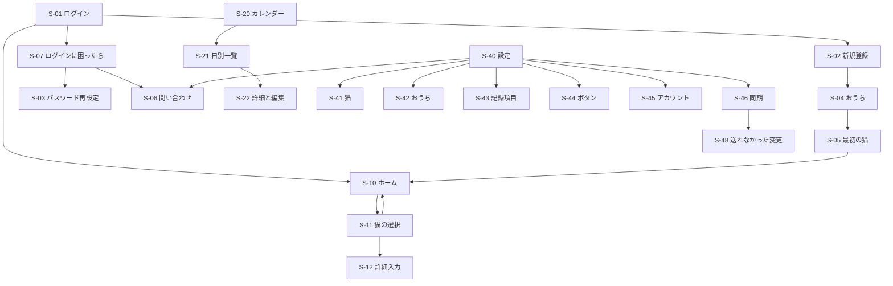

# 画面設計書：MeowScope

| 項目 | 内容 |
|---|---|
| 文書番号 | 04 |
| 版数 | 0.59 |
| 作成日 | 2026-11-02 |
| 作成者 | major182 |
| 前提となる文書 | [01 要件定義書](01_requirements.md) |

---

## 1. 全体の方針

- アプリを開いた最初の画面はホームとする
- 記録は「項目を選ぶ → おうちの猫を選ぶ → 保存」の流れとする。猫が1匹のときは猫の選択を省く
- 記録は即座に保存し、保存の後に「詳細を追加」を数秒表示する。詳細の入力は任意で、後からでも追加できる
- カレンダーと統計は、画面上部で全員または1匹に絞り込む。統計は1匹の表示を基本とする
- ホームには同期の状態を小さなアイコンと最終同期時刻で示す。押すと手動で同期し、未送信の件数は S-46 で確認する
- 猫とユーザーは、名前が出る場面では「アイコン＋名前」で表示する
- アプリは日本語（ja_JP）で表示する。漢字は日本語の字形で出し、日付の選択などの部品も日本語にする（言語を指定しないと、日本語と中国語で共通の漢字が中国語の字形で出ることがある）
- 記録項目のアイコンはイラストとする。ホームのボタンは猫の入ったイラスト、カレンダーは小さくても見分けられる専用のイラスト（道具などを切り出したもの）を別に用意する。メモの印もイラストを用意する
- アプリのアイコンは `mainicon_01` を基本とする。端末によってアイコンの形が丸と四角に分かれるため、`mainicon_02` も用意している。Windows（exe・タスクバー・インストーラー）と Android の丸いアイコン（roundIcon）は `mainicon_01`、Android の四角いアイコンは `mainicon_02`。作り方は `app/tool/launcher_icons`：Android は2つの設定（丸 → 四角の順に flutter_launcher_icons を動かす）、Windows は `windows_ico.dart`（タスクバーなどが使う 16〜64px と 256px を1つの ico に入れる）。ウィンドウの名前は「MeowScope」
- メールアドレスとパスワードの入力欄は全角を受け付けない。コピーと貼り付けは許可するが、全角が混ざった内容は貼り付け自体を受け付けず、入力欄を変えないまま案内を表示する
- 削除の確認では、誤操作を防ぐためボタンの位置を通常と入れ替え、左に実行、右にキャンセルを置く（BR-29）
- ダイアログの見出しなどの短い文は、折り返すときに言葉の切れ目（助詞や記号の後ろ）で切り、行の長さをそろえる。1文字だけが次の行に回ったり、言葉の途中で切れたりしないようにする
- 選択のボタン（性別・週の始まり・量など）は、選んだものに ✓ を出してそろえる
- 上端・下端までスクロールしても、画面が伸びる表現（オーバースクロール）は出さない（利用者の要望）
- グラフは触っても値を出さない（指の動きを取らず、グラフの上からでもページをスクロールできるようにする）
- 端末への保存（記録・猫・記録項目・おうち名・ウィジェットのボタンなど）に失敗したら「保存できませんでした。もう一度お試しください」を出し、保存のボタンを押せる状態に戻して画面に残る
- ホームの「今日の記録」とカレンダーの「今日」は、アプリを開いたまま日付が変わったら新しい日に切り替える
- Android の下部メニューは、ホーム、カレンダー、統計、設定の4つとする
- Windows は幅に合わせて左にメニューを置き、カレンダーと日別一覧を並べて表示する
- 広い幅（900px 以上）では、ホームの記録のボタンの幅を 160px までにし、窓が広いほど列を増やす。入力欄とボタンが中心の画面は、中身の幅を 640px までにして中央に寄せる（NF-UX-02）

## 2. 画面一覧

| ID | 画面 | 関連する要件 |
|---|---|---|
| S-01 | ログイン | F-AU-01 |
| S-02 | 新規登録 | F-AU-01 |
| S-03 | パスワード再設定 | F-AU-03 |
| S-04 | おうちの作成または参加 | F-SH-02、F-SH-04、BR-21 |
| S-05 | 最初の猫の登録 | F-SH-01、F-SH-05 |
| S-06 | ログの書き出しと問い合わせの案内 | F-LG-04 |
| S-07 | ログインに困ったら | F-AU-03、F-LG-04 |
| S-10 | ホーム | F-RC-01 |
| S-11 | 猫の選択 | BR-23 |
| S-12 | 記録の詳細入力 | F-RC-02、F-RC-03、F-RC-04 |
| S-20 | カレンダー | F-VW-01 |
| S-21 | 日別一覧 | F-VW-02 |
| S-22 | 記録の詳細と編集 | F-VW-02 |
| S-30 | 統計 | F-ST-01、F-ST-02 |
| S-40 | 設定 | - |
| S-41 | 猫の一覧とプロフィール | F-SH-05、F-SH-06、F-SH-07、F-SH-08 |
| S-42 | おうちの管理 | F-SH-03、F-SH-04、BR-19 |
| S-43 | 記録項目の設定 | F-RC-05、BR-22 |
| S-44 | ウィジェットのボタン設定（Android） | F-WG-01、BR-22 |
| S-45 | アカウント設定 | F-AU-02、BR-16 |
| S-46 | 同期の状態 | F-OF-03 |
| S-47 | しきい値の設定 | F-AN-01、BR-20 |
| S-49 | 通知の設定 | F-NT-05、BR-13、BR-20 |
| S-50 | お薬の予定 | F-MD-02、F-NT-01、BR-06 |
| S-48 | 送れなかった変更 | F-OF-03 |
| S-51 | 更新のお知らせ（ダイアログ） | F-UP-01、F-UP-02、BR-33 |

## 3. 画面遷移



## 4. ホーム（S-10）

```text
おうち名            11/02  同期済み
+-----+-----+-----+-----+
| ご飯 |  水  |  薬  | 尿  |
+-----+-----+-----+-----+
| 便  | 吐いた| 体重 |ブラシ|
+-----+-----+-----+-----+
|  ＋  |
+-----+
今日の記録
 08:10 (猫)ミケ ご飯
       量：多い　メモ：完食
 09:30 (猫)タマ おしっこ
------------------------
ホーム カレンダー 統計 設定
```

今日の記録は、時刻・猫・項目の下に詳細を出す。Windows は写真以外のすべて（量・体重・メモ・投稿者）を出し、メモは全文とする。Android は一覧が長くならないよう量とメモだけを出し、2行までで省略する。詳細がない記録は1行のまま。

## 5. その他の画面のイメージ

### S-01 ログイン

```text
MeowScope
------------------------
メールアドレス
+----------------------+
|                      |
+----------------------+
パスワード
+----------------------+
|                      |
+----------------------+
+----------------------+
|      ログイン        |
+----------------------+
------------------------
新規アカウント作成
ログインに困ったら
                Ver.1.0.0
```

- 画面の下に今の版を出す（F-UP-03）。ビルド番号は出さない

### S-02 新規登録

```text
< 新規アカウント作成
------------------------
名前（記録に投稿者として表示）
メールアドレス
パスワード（8〜64文字）
+----------------------+
|       登録する       |
+----------------------+
```

- 名前は20文字まで。メールアドレスとパスワードは半角だけ（BR-26）
- 登録できたら S-04 へ進む。登録済みのメールアドレスはその旨を出す
- ログインの失敗は、メールアドレスとパスワードのどちらが違うかを区別せずに出す。続けて失敗したら、しばらく待つよう案内する（NF-SC-03）。サーバーの異常のときだけ問い合わせ番号を出す（F-LG-02）

### S-07 ログインに困ったら

```text
< ログインに困ったら
------------------------
+----------------------+
|   パスワード再発行   |
+----------------------+
+----------------------+
|      問い合わせ      |
+----------------------+
```

「パスワード再発行」は S-03 を開く。「問い合わせ」は S-06 を開く。

### S-03 パスワード再設定

```text
< パスワード再設定
------------------------
登録したメールアドレスに、
6桁の確認コードを送ります
メールアドレス
+----------------------+
|                      |
+----------------------+
+----------------------+
|  確認コードを送る    |
+----------------------+
------------------------
確認コード（6桁）
+----------------------+
|                      |
+----------------------+
新しいパスワード（8〜64文字）
+----------------------+
|                      |
+----------------------+
+----------------------+
|  パスワードを変更    |
+----------------------+
```

- 「確認コードを送る」の後は、登録の有無にかかわらず「登録済みのメールアドレスに確認コードを送りました。届かない場合は、メールアドレスをお確かめの上、60秒後に再度実施して下さい。」と出し、コードと新しいパスワードの欄を出す。秒数は毎秒数え下げ、0 になったら秒数を除いた文にする
- ボタンは「確認コードを送り直す」に変わり、数え下げの間（60秒）は押せない（サーバーも1分以内の送り直しではメールを送らない）
- 送り直しの待ち時間（60秒）の間に前の画面へ戻って開き直したら、入力したメールアドレス・案内・残りの秒数・コードの欄を元に戻す（開き直すと送り直せるように見えてしまうのを防ぐ）。60秒が過ぎてから開き直したら、何も戻さない（入力したメールアドレスを残し続けないため）。パスワードを変えたときとアプリを終えたときも忘れる
- 説明の文は「メールに届いた確認コード（15分有効）と、新しいパスワードを入れてください」。確認コードは数字だけを6桁まで入れられる。空なら「確認コードを入力してください」、6桁でなければ「確認コードは6桁の数字です」と出す。新しいパスワードは新規登録と同じ決まり（半角、8〜64文字）
- 変えたらそのままログインし、最初の画面（ホームかおうちの作成）へ進む。ほかの端末はログインし直しになる
- コードが違う・期限切れ・5回間違えたときは「確認コードが違うか、期限が切れています。5回間違えたときや15分過ぎたときは、コードを送り直してください」と出す
- メールは Gmail の SMTP で送る（技術選定書 2章）。サーバーにメールの設定がなければ送らない（画面の動きは同じ）

### S-04 おうちの作成または参加

```text
おうちを準備します
------------------------
+----------------------+
|  新しいおうちを作る  |
+----------------------+
おうちの名前
+----------------------+
|                      |
+----------------------+
+----------------------+
| 招待されたおうちに参加|
+----------------------+

       ログアウト  アカウントを削除
```

おうちを作った人はログイン中のユーザーで、記録の投稿者名には新規登録（S-02）で入れた名前を使う（BR-17）。「招待されたおうちに参加」では、LINE などで届いた招待の文をそのまま貼り付けて参加する。Android は招待のリンクを押すとアプリが開き、この画面にトークンが入った状態で出る。

おうちを抜けた人もこの画面に戻るので、画面の下に小さく「ログアウト」と「アカウントを削除」を置く（新規登録した人も見る画面なので目立たせない）。アカウントの削除は確認してから行い、おうちがないので記録を残すかは聞かない（AC-01、BR-15）。

認証の実装の前に端末で作ったデータ（仮の利用者・おうち・猫・記録）は試しのデータとして扱い、アカウントへは引き継がない。認証の実装で端末の DB から消し、ログインの後に S-04 から作り直す。

### S-05 最初の猫の登録

```text
猫を登録しましょう
------------------------
名前
+----------------------+
|                      |
+----------------------+
以下は任意です
生年月日
+------------+
|            |
+------------+
性別
+------+------+------+
|男の子|女の子| 不明 |
+------+------+------+
持病
+----------------------+
|                      |
+----------------------+
+----------------------+
|       登録する       |
+----------------------+
```

- 写真（アイコン）は登録の時には入れず、登録の後に猫のプロフィール（S-41）で設定する

### S-06 ログの書き出しと問い合わせの案内

```text
< 問い合わせ
------------------------
不具合があったときは、ログを保存して
次の宛先へ添付して連絡してください
問い合わせ先：<問い合わせ先の Gmail>
+----------------------+
|    ログを保存する    |
+----------------------+
+----------------------+
|  宛先をコピーする    |
+----------------------+
```

- 問い合わせ先はビルドのときに設定で渡し（リポジトリには書かない）、設定がなければその旨を出して「宛先をコピーする」を押せないようにする
- 「ログを保存する」で保存した場所を出す。保存できないときは「ログをコピーする」を案内する

### S-11 猫の選択

```text
ご飯：どの子ですか？
------------------------
+----------+----------+
| (猫)ミケ | (猫)タマ |
+----------+----------+
------------------------
キャンセル
```

### S-10 保存の後

```text
------------------------
ミケのご飯を記録しました
+------------+
| 詳細を追加 |   数秒で消える
+------------+
------------------------
ホーム カレンダー 統計 設定
```

### S-12 記録の詳細入力（ご飯の例）

```text
< ご飯            [保存]
------------------------
猫    (猫)ミケ
日時
+----------------------+
| 11/02 08:10          |
+----------------------+
以下は任意です
量
+------+------+------+
| 少し | 普通 | 多い |
+------+------+------+
+------+
| 写真 |
+------+
メモ
+----------------------+
|                      |
+----------------------+
```

項目ごとの入力欄は次のとおりとする。

| 入力欄 | 対象の項目 | 決まり |
|---|---|---|
| 日時 | すべて | 未来は選べない |
| 量（少し・普通・多い） | ご飯・水・おしっこ・うんち・吐いた・独自の項目 | 選んだものをもう一度押すと取り消す |
| 体重 | 体重 | 0.1〜30 kg |
| メモ | すべて | 1000文字まで。前後の空白を除き、空白だけなら空とする |

写真は3枚まで付けられ、3枚あれば追加のボタンを押せない（AC-03）。写真はその場で保存し、「保存」を押さなくても付く。Android はカメラかアルバム、Windows はファイルから選ぶ。記録の詳細（S-22）では写真を並べ、端末になくオフラインのときは「オンラインで表示できます」と出す（BR-28）。

### S-20 カレンダー

```text
[全員 v]   < 2026年11月 >
 日  月  火  水  木  金  土
+---+---+---+---+---+---+---+
| 1 | 2 | 3 | 4 | 5 | 6 | 7 |
|食尿|食水|   |   |   |   |   |
|便 |吐メ|   |   |   |   |   |
+---+---+---+---+---+---+---+
| 8 | 9 |10 |11 |12 |13 |14 |
|   |   |   |   |   |   |   |
+---+---+---+---+---+---+---+
  ...（6行）
------------------------
ホーム カレンダー 統計 設定
```

- セルには、その日の記録の項目のイラストを標準の項目の順に1つずつ並べ、メモがあれば最後にメモのイラストを付ける。独自の項目は標準の後ろに並べる
- 標準の項目はカレンダー用のイラスト（`cal_*`）、独自の項目は選んだイラストを使う。メモは `cal_memo`
- 前月と翌月の日は薄く表示する。今日は太字にする
- 猫の誕生日（生年月日の月日）には、日のセルの右上に誕生日のアイコン（イラストがないので標準のケーキのアイコン）を出す（BR-32）。絞り込みで1匹を選んでいるときは、その猫の誕生日だけを出す。生年月日が未登録の猫とお別れの猫には出さない
- 狭い幅では、日を押すと日別一覧（S-21）を開き、絞り込みを引き継ぐ。広い幅（900px 以上）では、日別一覧を右に並べ、押した日に切り替える

### S-21 日別一覧

「<」「>」で前後の日へ移動する。記録は時刻の古い順に並べる。

```text
戻る    < 11月 2日 >
------------------------
+----------------------+
| 08:10 (猫)ミケ ご飯 [メ]|
+----------------------+
| 09:30 (猫)タマ おしっこ|
+----------------------+
| 12:00 (猫)ミケ 吐いた[写]|
+----------------------+
```

- メモの印（イラスト）と写真の印を、記録の右に出す。写真の印はイラストがないので、標準のカメラのアイコンを使う

### S-22 記録の詳細と編集

```text
< 記録の詳細  [編集][削除]
------------------------
(猫) ミケ   吐いた
11/02 12:00   投稿者：(人)○○
量    少し
+----------------------+
|        写真          |
+----------------------+
メモ  毛玉のよう
```

入力していない詳細は表示しない（詳細が1つもなくても、その旨の文は出さない）。削除の確認は BR-29 に従う。

### S-30 統計

```text
[ミケ v]        +---+---+
                | 週| 月|
                +---+---+
体重 (kg)
4.2 |      ._._.
4.0 |__.__/
------------------------
回数の推移  [ご飯 v]
3 | #  #  #  #
2 | #  #  #  #  #  #
------------------------
体調のようす    < 11/9(月) >
[外れ値 1個]（色の帯）
  ご飯　1回               少なめ
  ふだん 2〜4回
[範囲内]（色の帯）
  水　5回
  ふだん 3〜6回
  体重　4.2kg（11/8 の記録）
  ふだん 3.9〜4.4kg
------------------------
ホーム カレンダー 統計 設定
```

- 1匹を選んで表示する。最初は登録順で先頭の猫とし、お別れの猫も選べる
- 「週」は今日までの7日、「月」は今日までの30日を日ごとに表示する
- 体重は、数値を入力した体重の記録を折れ線で結ぶ。記録がなければその旨を表示する
- 回数の推移は、選んだ項目の日ごとの回数を棒で表示する。体重は項目の選択に出さない
- いつもとの差の通知から開いたときは、その猫と項目を選んだ状態で開く（体重のときは項目は最初のまま）。下部メニューのない画面として開き、戻ると元の画面に戻る

**体調のようす（F-ST-02）**

選んだ猫・日の各項目の値を、その猫のふだんの範囲と並べる。範囲と判定は、いつもとの差の通知（BR-20・31）と同じ計算を使うので、画面と通知の判定は一致する。

| 項目 | 決まり |
|---|---|
| 日付 | 最初はきのう（記録が出そろった日）。「<」「>」で1日ずつ切り替え、今日まで選べる。いつもとの差の通知から開いたときは、判定した日を出す |
| 出す項目 | ご飯・水・おしっこ・うんち・吐いた・体重（記録項目の並び順）。薬・ブラシ・独自の項目は判定しないので出さない |
| 並び | 外れ値を上にまとめ、その下に範囲内。見出しは色の帯（外れ値は警告の色）で「外れ値 ○個」（なければ「外れ値はありません」）と「範囲内」。行の間に区切りの線を引く。日付を切り替えても、画面の位置はそのまま |
| 回数の範囲（統計の方式） | その日より前の28日（今日を選んだときは前日より前の28日）の平均 ±2標準偏差。外れ値になるのは平均と1回以上違うときだけなので、判定と同じになる整数（この回数なら範囲内）で出す（例：1.6〜4.3回で平均3回なら「ふだん 2〜4回」）。0回より下にしない |
| 体重の範囲 | その記録より前の28日の平均の ±5%（しきい値の方式では決めた割合）。その日に記録がなければ、それより前の最新の記録を「（11/8 の記録）」と日付つきで出す。比べる記録がなければ「比べる記録がありません」、記録がなければ「体重　記録なし」 |
| しきい値の方式 | 範囲の見出しを「しきい値」にし、決めた下限・上限で判定する。決めていない項目は「しきい値なし」 |
| 少なすぎを見ない日 | 今日は1日の途中なので多すぎだけを見る（説明の文は出さない）。記録が1件もない日は、家族が記録していないだけかもしれないので、少なすぎを見ない（「この日は記録がないため、少なすぎは見ません」）。このとき範囲は「ふだん 4回以下」と上限だけを出す |
| 記録が足りないとき | 統計の方式で、ふだんの28日に記録のある日が7日に満たなければ「まだ判定できません（記録が7日分たまると判定します。あと○日）」 |
| 外れ値の印 | 回数は「少なめ」「多め」、体重は「減っています」「増えています」を、警告の色で右に出す |

### S-40 設定

```text
設定
------------------------
+----------------------+
| 猫の一覧とプロフィール>|
+----------------------+
| おうちの管理        > |
+----------------------+
| 記録項目の設定      > |
+----------------------+
| お薬の予定          > |
+----------------------+
| 通知の設定          > |
+----------------------+
| ウィジェットのボタン > |  Android のみ
+----------------------+
| アカウント          > |
+----------------------+
| 同期の状態          > |
+----------------------+
| 問い合わせ          > |
+----------------------+
| カレンダーの週の始まり|
| 日曜 / 月曜（既定は日曜）|
+----------------------+
| アプリの更新          |
| Ver.1.0.0  [更新を確かめる]|
+----------------------+
------------------------
ホーム カレンダー 統計 設定
```

- 週の始まりは押すとすぐに保存し、カレンダーに反映する
- 「アプリの更新」に今の版を出す（F-UP-03）。「更新を確かめる」を押すと、サーバーに新しい版を聞く（F-UP-01）。新しい版があれば S-51 を出す。なければ「最新の版です」、確かめられなければ「更新を確かめられませんでした。通信を確かめてください」を画面の下に出す
- まだ作っていない画面の項目は、作るまで「準備中」と表示し、押せないようにする（今は該当なし）

### S-41 猫の一覧とプロフィール

```text
< 猫              [追加]
------------------------
+----------------------+
| (猫) ミケ  3歳      > |
+----------------------+
| (猫) タマ  5歳      > |
+----------------------+
| (猫) ソラ  お別れ   > |
+----------------------+
```

- 一覧には登録順に、年齢（1歳以上は「N歳」、1歳未満は「Nか月」。生年月日がなければ空）またはお別れを表示する
- 猫を押すとプロフィールを開く。項目は S-05 と同じに、アイコン（写真）の変更を加えたもので、「保存する」で一覧へ戻る
- プロフィールの下に「お別れにする」（お別れの猫は「お別れを取り消す」）と「削除する」を置く。お別れの猫は記録の対象から外れ、記録は残る（BR-25）
- 削除は確認の後に行い、その猫と記録を消す。確認では、記録を残すときはお別れを使うよう案内する（BR-27、BR-29）

### S-42 おうちの管理

```text
< おうちの管理
------------------------
おうち名
+----------------------+
|                      |
+----------------------+
メンバー  (人)○○ / (人)△△
+----------------------+
|   リンクで招待する   |
+----------------------+
+----------------------+
|    おうちを抜ける    |
+----------------------+
```

- おうち名は「保存」で同期待ちに入れる（オフラインでも変えられる）。空（空白だけも）なら「おうちの名前を入力してください」を出して保存しない。50文字まで入れられる
- メンバーは同期で受け取った今のメンバー
- 「リンクで招待する」で招待の文（おうちの名前、リンク、開けないときの案内）を作ってコピーし、LINE などで送ってもらう。リンクは60分・1回だけ使える
- メールでの招待はしない（リンクでの招待があるため）
- おうちを抜けるときは記録を残すか消すかを選ぶ。最後の1人のときは、おうちと記録がすべて消える旨の削除の確認を出す（BR-19）。抜けたらおうちの作成（S-04）へ戻る。通信が要る

### S-43 記録項目の設定

```text
< 記録項目        [追加]
------------------------
+----------------------+
| ご飯（標準）         |
+----------------------+
| ブラシ（標準）       |
+----------------------+
| 通院   [編集][非表示]|
+----------------------+
```

独自の項目の追加と編集では、名前を入力し、アイコンをアプリが用意したイラストの一覧から選ぶ（F-RC-05）。

- 名前は必須で20文字まで。同じおうちの他の項目と同じ名前は使えない
- 独自の項目は標準の項目の後ろに、追加した順に並べる。ホームのボタンにも同じ順で並ぶ
- 標準の項目は名前もアイコンも変えられず、非表示にもできない
- 独自の項目は削除できず、非表示にできる。非表示の項目には「非表示中」と出す。ホームのボタンと統計の項目の選択には出さず、過去の記録はカレンダー・日別一覧・詳細にそのまま出る。「表示に戻す」で戻せる
- 非表示の項目と同じ名前の項目は追加できない
- アイコンは、通院・遊び・爪切り・歯みがき・おやつ・その他のイラストから選ぶ。イラストが見つからない値は「その他」で表示する

### S-44 ウィジェットのボタン設定

```text
< ウィジェットのボタン
------------------------
+----------------------+
| ご飯           [削除]|
+----------------------+
| 薬             [削除]|
+----------------------+
+----------------------+
|    ボタンを追加      |
+----------------------+
```

- ボタンはアカウントに保存し、同期で機種変更でも引き継ぐ（BR-22、AC-13）。おうちの記録項目なので、今のおうちの項目のボタンだけを出す
- 1人4つまで。4つになると「ボタンを追加」を押せなくし、「ボタンは4つまでです」と出す
- 「ボタンを追加」で記録項目を選ぶ。非表示の項目と、ボタンにした項目は選択に出さない。追加したボタンは最後に並ぶ
- 左のつまみをドラッグして並べ替える。ウィジェットにもこの順で並ぶ
- 後から非表示にした項目のボタンは「非表示中」と出し、ウィジェットには出さない。削除で外せる

### S-45 アカウント設定

```text
< アカウント
------------------------
+------+
| (人) |  アイコン
+------+
名前
+----------------------+
|                      |
+----------------------+
+----------------------+
|  パスワードを変更    |
+----------------------+
+----------------------+
|     ログアウト       |
+----------------------+
+----------------------+
|  アカウントを削除    |
+----------------------+
```

- 名前は「保存」で送る。これからの記録の投稿者名になり、過去の記録の投稿者名は変えない（BR-17）
- パスワードの変更は、今のパスワードと新しいパスワードを入れる。変えると他の端末はログインし直しになる
- ログアウトするとログイン（S-01）へ戻る
- アカウントの削除は、記録を残すか消すかを選び、削除の確認の後に行う。通信が要る
- アイコンは押して画像を選ぶ。サーバーへ送るので通信が要る

### 猫の削除の確認（S-41 から開く）

```text
ミケを削除しますか？
ミケの記録もすべて消えます。記録を残すときは
「お別れにする」を使ってください
------------------------
+----------+----------+
|   削除   |キャンセル|
+----------+----------+
```

### 退会とおうちを抜けるときの確認（S-42、S-45 から開く）

```text
おうちの記録を残しますか？
------------------------
+----------+----------+
|   残す   |   消す   |
+----------+----------+
キャンセル
```

### S-47 しきい値の設定

通知の設定（S-49）で判定方式に「自分で決めたしきい値」を選んだときだけ、S-49 に入口を表示する。

```text
< しきい値の設定
[ミケ v]
------------------------
+----------------------+
| ご飯  [下限]〜[上限]回 |
+----------------------+
| 水    [下限]〜[上限]回 |
+----------------------+
  ...（おしっこ・うんち・吐いた）
+----------------------+
| 体重  ±[ 5 ]%         |
+----------------------+
+----------------------+
|       保存する       |
+----------------------+
```

- 回数の対象は BR-31 と同じ（ご飯・水・おしっこ・うんち・吐いた）。下限と上限はどちらも任意で、空ならその向きは判定しない。0〜99 の整数で、下限は上限以下
- 体重は 1〜50 の整数（%）。既定は 5
- しきい値は猫ごとに持ち、おうちの家族と共有する（同期する）。「保存する」で保存し、「しきい値を保存しました」を出す。範囲の外は「0〜99の数字で入れてください」「1〜50の数字で入れてください」、下限が上限より大きければ「下限は上限以下にしてください」を出して保存しない。体重が既定の5%なら保存しない（既定が変わったら追いつけるように）
- 判定は BR-31 のとおり端末で行う。統計の方式では、前日に記録が1件もない猫は前日の回数を判定しない（記録していないだけかもしれないため）。回数の差が1回未満なら出さない（いつも同じ回数の猫で、わずかな違いを出さないため）。体重の差の割合は小数1桁に丸めてから比べる

### S-49 通知の設定

```text
< 通知の設定
------------------------
お薬の時間            [オン]
  お薬の予定の時刻に、毎日通知します
いつもとの差          [オン]
  アプリを開いて同期したとき、…
記録忘れ              [オン]
  猫ごとに、最後の記録から…
  最後の記録から [10] 時間
家族の記録            [オン]
  同期した際に家族が記録を…
猫の誕生日            [オン]
  猫の誕生日の当日、朝9時に通知します
------------------------
いつもとの差の判定方式
(●) ふだんの傾向から自動で判定
( ) 自分で決めたしきい値
  しきい値の設定        >
```

- 種類の名前の下に、どんなときに知らせるかを小さい字で出す。お薬の時間「お薬の予定の時刻に、毎日通知します」、いつもとの差「アプリを開いて同期したとき、記録の回数や体重がふだんと違えば通知します」、記録忘れ「猫ごとに、最後の記録から決めた時間がたっても記録がなければ通知します」、家族の記録「同期した際に家族が記録を行っていた場合、通知します（アプリを開いている間）」、猫の誕生日「猫の誕生日の当日、朝9時に通知します」
- 種類ごとのオン・オフと記録忘れの時間は、アカウントの設定として同期する（機種変更でも引き継ぐ）。記録忘れの時間は 1〜48 の整数で、既定は 10。範囲の外や数字でないときは「1〜48の数字で入れてください」を出して保存しない。ほかの項目は変えたらすぐ保存する
- Android で通知が許可されていないときは、上部に「通知が許可されていません」と「許可する」を出す
- 通知の許可は、通知が初めて必要になったときにも OS の確認で求める。お薬の予定（通知するもの）を保存したとき（お薬の時間）、生年月日のある猫を保存したとき（猫の誕生日）、記録したとき（記録忘れ・いつもとの差）。その種類の通知がオンで、まだ許可されていないときだけとし、端末で1回だけ求める（断られたら、あとはこの画面の案内に任せる）。Windows では求めない
- Windows は通知を出さず、アプリの起動中に画面の下に知らせる。窓が手前になければ、タスクバーのアイコンを点滅させる（手前に出すと止まる。BR-09）。Windows で知らせるのはいつもとの差と誕生日だけで、記録忘れ・お薬の時間・家族の記録はこの画面にも出さない。誕生日は、その時刻にアプリが起動していれば知らせる

### S-50 お薬の予定

```text
< お薬の予定
------------------------
(猫)ミケ
  08:00  ○○錠 1錠      [オン]
  20:00  ○○錠 1錠      [オン]
(猫)タマ
  09:00  目薬           [オフ]
------------------------
+----------------------+
|     予定を追加       |
+----------------------+
```

- 予定を押すと編集の画面を開く。項目は、猫（選ぶ）、薬の名前（必須・20文字まで）、量（任意・20文字まで）、時刻（毎日。既定は 08:00）、オン・オフ。削除もここで行う（確認で「家族の端末からも消え、お薬の時間の通知も止まります」）
- 一覧のスイッチで、オン・オフをすぐ保存する。予定がなければ「お薬の予定はまだありません」を出す
- 同じ猫の同じ薬を1日に何回か与えるときは、時刻ごとに予定を1つずつ作る
- 入力チェックの文は「猫を選んでください」「薬の名前を入力してください」「20文字以内で入れてください」。保存したら「お薬の予定を保存しました」を出して一覧へ戻る
- お別れの猫は選べない。猫がお別れになったら、その猫の予定は通知しない。一覧には猫の名前に「（お別れ）」を付けて残し、編集もできる。選べる猫がいなければ「予定を追加できる猫がいません。先に猫を登録してください」を出し、保存できない
- お薬の時間の通知は、毎日の繰り返しとして端末（Android）に予約する。アプリを閉じていても、何日も開かなくても毎日出る
- 予定はおうちの家族と共有する（同期する）。通知を出すかは、各自の通知の設定（S-49）に従う

### 通知の文

| 種類 | 文 |
|---|---|
| お薬の時間 | 「ミケのお薬の時間です」。2行目に「○○錠 1錠」（量がなければ薬の名前だけ） |
| いつもとの差（回数） | 「ミケのご飯がいつもより少なめです」（多いときは「多めです」）。2行目に「きのう 1回（ふだん 3回くらい）」（今日の多すぎは「きょう 6回」。しきい値の方式では、かっこを「下限 1回」「上限 5回」にする） |
| いつもとの差（体重） | 「ミケの体重がいつもより 6% 増えています」（減ったときは「減っています」） |
| 記録忘れ | 「ミケの記録が10時間ありません」 |
| 家族の記録 | 「なつさんがミケのご飯を記録しました」。同期で何件も受け取ったときは「なつさんが3件記録しました」とまとめる |
| 誕生日 | 「今日はミケの誕生日です。3歳おめでとう！」 |

- いつもとの差は、アプリを起動してから最初に同期が成功したときに1回だけ判定する（BR-05）。同じ猫・同じ種類は1日1回まで（BR-12）

- 家族の記録は、同期で受け取った自分以外の人の新しい記録だけを知らせる（BR-08）。編集・削除と、お別れの猫の記録は知らせない。ログインした直後の最初の同期と全件の取り直しでは、過去の記録がまとめて届くので知らせない
- 通知を押すとアプリを開く。家族の記録は、最初の記録の日の日別一覧（S-21）を開き、まとめた記録がすべて同じ猫ならその猫で絞る。いつもとの差は、その猫と項目の統計（S-30）を開き、体調のようすはその日（判定した日）を出す
- 通知の文に、メモや記録の詳細は入れない

### S-51 更新のお知らせ

起動したとき（ログインしていればすぐ、していなければログインした後。更新の API は認証が要るため）と、設定の「更新を確かめる」で新しい版が見つかったら出す（BR-33）。

```text
+----------------------------+
| 新しい版があります          |
|                            |
| Ver.1.0.1 に更新できます    |
| （今の版 Ver.1.0.0）        |
| 更新すると、アプリを一度    |
| 閉じて開き直します          |
|                            |
| [5分後に知らせる] [今すぐ更新]|
+----------------------------+
```

- 「5分後に知らせる」：閉じて、アプリを使っている間の5分後にもう一度出す。アプリはそのまま使える
- 「今すぐ更新」：ダイアログの中で「更新を取ってきています（45%）」と進み具合を出す。取り終えたら SHA-256 を確かめる
  - Android：OS のインストールの画面を出す。利用者が「更新」を押すと入り、開き直す。初めてのときは、先に「この提供元のアプリを許可」の画面を出し、許可して戻るとインストールの画面を出す（OS の案内から許可すると、インストールに戻らないため）
  - Windows：アプリを閉じ、インストーラーを確認なしのモードで動かし、入れた後にアプリを開き直す
- 取ってこられない・SHA-256 が合わないときは「更新を取ってこられませんでした。もう一度試してください」を出してダイアログを閉じ、取りかけのファイルを消す。アプリはそのまま使える
- 更新のファイルは、入れた後の次の起動で消す。取りやめ（Android のインストールの画面で「キャンセル」）や失敗のときも消す
- 開発版（MeowScope Dev）も確かめる。確かめる先は開発用のサーバー（手元の Docker）で、そこには開発版のファイルを置く
- 戻るボタンで閉じたときは「5分後に知らせる」と同じにする。取ってきている間は閉じられない

### S-46 同期の状態

```text
< 同期の状態
------------------------
最終同期  11/02 09:30
未送信    2件
+----------------------+
|     今すぐ同期       |
+----------------------+
```

- 未送信は、同じ行の変更を1件として数える
- サーバーが受け付けなかった変更があれば、その件数を出す。押すと S-48 へ進み、どの変更か、どうすればよいかを確かめられる（自動では再送しない）
- 前回の同期に失敗したら理由を出し、サーバーの異常のときは問い合わせ番号も出す（ログ設計書 4章）
- ログインの期限が切れたら、その旨と「ログインし直す」を出す。記録は端末に残り、入り直した後に送る
- ホームの上部の印は、同期済み・未送信あり・同期中・失敗の4つの形で、横に最終同期の時刻と状態の文（「同期済み」など。まだ同期していなければ「未同期」）を出す。押すとすぐに同期する

### S-48 送れなかった変更

```text
< 送れなかった変更
------------------------
次の変更は端末に残っていますが、
サーバーに送れていません
+----------------------+
| 11/05 08:10 ミケのご飯 |
| 送れなかった日時 11/05 09:30 |
| 原因 「量」の内容が…   |
| 対応 「量」を直して…   |
| [記録を開く][一覧から消す][送り直す] |
+----------------------+
解決しないときは問い合わせる
```

- 変更ごとに、何の変更か（記録は「日時 猫の名前の項目」、猫・記録項目・ウィジェットのボタン・おうち・設定はその名前）と、送れなかった日時を出す。端末から消えた行は「削除された記録」などと出す
- サーバーが返した理由（API 設計書 5章）ごとに、原因と対応を出す

| 理由 | 原因 | 対応 | 送り直す |
|---|---|---|---|
| `unknown_table` | サーバーがこの種類のデータにまだ対応していない（版の違い） | サーバーが新しくなった後に送り直す。送れないままなら問い合わせる | 出す |
| `forbidden` | このおうちに送る権限がない（別の端末でおうちを抜けた後など） | 送れないので、確かめたら一覧から消す | 出さない |
| `not_found`・`constraint` | もとになる猫・記録項目・記録がサーバーにない | もとのデータを確かめ、なければ記録し直して一覧から消す | 出す |
| `invalid` | 「（項目）」の内容が決まりに合わない | 「（項目）」を直してから送り直す | 出す |
| `too_many` | 数の上限を超えている（写真3枚・ボタン4つ） | 減らしてから送り直す | 出す |
| そのほか | サーバーが受け付けなかった | 送り直しても送れなければ問い合わせる | 出す |

- 「送り直す」は同期待ちに戻してすぐに同期する。その時点の端末の内容を送るので、直した後に押せばよい
- 「一覧から消す」は確認してから消す。その変更はサーバーに送らず、端末の内容はそのまま残る
- 記録とその写真は「記録を開く」で記録の詳細（S-22）へ進める
- 同じ行がまた送れなかったら、新しい理由で置き換える。後で送れたら一覧から消える

### Android のウィジェット

```text
+-----+-----+
| ご飯 |  薬  |
+-----+-----+
|  水  | 尿  |
+-----+-----+
```

猫を選ぶとき（ボタンを押した後。アプリは開かない）：

```text
  ご飯：どの子？
+------+------+
| ミケ | タマ |
+------+------+
|次へ ▶|やめる|
+------+------+
```

- 2×2 の枠に、S-44 で登録したボタンを並び順に出す。非表示の項目のボタンは出さない
- 猫が1匹なら、選ばずにすぐ記録する（BR-23）。2匹以上なら、ウィジェットの中身を猫の選択に切り替える（アプリは開かない）
- 猫が2匹なら「猫・猫・やめる」。3匹以上は1ページに2匹ずつ出し、「次へ ▶」で送る。最後のページの次は最初に戻る
- 猫を押すと、保存を待たずにすぐ「✓ ミケのご飯を記録しました」を2秒出し、元のボタンに戻る（待ちを感じさせないため）。保存は裏側で続け、できなければ「記録できませんでした。アプリを開いてください」を3秒出す
- 「やめる」と、15秒選ばずに置いたときは、記録せずに元のボタンに戻る
- 端末を長く休ませた後でも、期限の切れた表示（猫の選択・記録の結果）は残さない。戻す知らせは省電力の間でも届く形で掛け、念のため30分ごとにも描き直す（描き直すと、期限の切れた表示はボタンに戻る）
- 押してから10秒たっても保存が終わらなければ（アプリの更新の直後など、保存の処理が動かないとき）、失敗の文を3秒出す
- 記録は同期待ちに積み、つながればすぐに送る。つながらなければ、次にアプリを開いたときに送る
- ログインしていない・おうちがないときは「MeowScope を開いてください」、ボタンがないときは「設定でボタンを登録してください」と出し、押すとアプリを開く。猫がいないときは、ボタンを押すとアプリを開く
- 見た目はアプリのホームの記録のボタンに合わせる。枠は角丸と細い枠線で、項目のイラストの下に茶色の文字で名前を出す。猫を選ぶ枠には猫のイラストを出す。「次へ ▶」「やめる」は文字だけ
- イラストはアプリの中のもの（assets/icons）をそのまま使う。色はアプリの配色（#C2662D から作る色）に合わせ、端末の暗い表示にも合わせる
- 空いている枠や枠のすき間を押しても、何もしない（ランチャーの既定の動きでアプリが開かないようにする）

### Windows 版のカレンダー

```text
+--------+----------------------+----------+
| ホーム | [全員 v]  2026年11月  | 11月2日  |
| 暦     | 日 月 火 水 木 金 土  | 08:10 ご飯|
| 統計   | （カレンダー6行）     | 09:30 尿 |
| 設定   |                      |          |
+--------+----------------------+----------+
```

## 6. 改訂履歴

| 版数 | 日付 | 内容 |
|---|---|---|
| 0.1 | 2026-11-02 | 初版 |
| 0.2 | 2026-11-02 | 猫の絞り込み、保存後の導線、同期の表示を決定 |
| 0.3 | 2026-11-02 | 全画面のイメージを追加 |
| 0.4 | 2026-11-02 | 画面のイメージの枠線をそろえた |
| 0.5 | 2026-11-02 | アイコン、全角の制御、週の始まり、確認画面を追加 |
| 0.6 | 2026-11-02 | 全角の貼り付けの拒否、猫の削除を追加 |
| 0.7 | 2026-11-02 | 削除の確認のボタンの配置を追加 |
| 0.8 | 2026-11-02 | ログの書き出しと問い合わせの案内（S-06）を追加 |
| 0.9 | 2026-11-02 | ログイン画面の導線を変更（S-07 を追加） |
| 0.10 | 2026-11-02 | 日別一覧の日付移動、しきい値の設定（S-47）を追加 |
| 0.11 | 2026-11-02 | しきい値を猫ごとに変更 |
| 0.12 | 2026-11-03 | 標準の項目にブラッシングを追加、アイコンの方針を追加 |
| 0.13 | 2026-11-03 | ログインまでの S-04 の扱いを追加 |
| 0.14 | 2026-11-03 | 記録の詳細入力の入力欄と、詳細の表示の決まりを追加 |
| 0.15 | 2026-11-03 | カレンダーの印と、広い幅の並べ方を追加 |
| 0.16 | 2026-11-03 | 統計の期間と表示の決まりを追加 |
| 0.17 | 2026-11-03 | 猫の一覧とプロフィールの決まりを追加 |
| 0.18 | 2026-11-03 | 記録項目の設定の決まりを追加 |
| 0.19 | 2026-11-03 | 設定の週の始まりと、準備中の項目の扱いを追加 |
| 0.20 | 2026-11-03 | カレンダーと独自の項目のイラストを反映 |
| 0.21 | 2026-11-03 | 独自の項目の非表示を追加（削除はしない） |
| 0.22 | 2026-11-03 | 認証の前に作ったデータは引き継がないことを追加 |
| 0.23 | 2026-11-03 | 新規登録（S-02）を追加、S-04 の名前の欄を削除、S-07 と S-45 の現状を記入 |
| 0.24 | 2026-11-03 | 同期の状態（S-46）とホームの同期の印の決まりを追加 |
| 0.25 | 2026-11-03 | 写真の付け方と表示の決まりを追加 |
| 0.26 | 2026-11-03 | おうちの管理（S-42）とアカウント設定（S-45）の決まりを追加 |
| 0.27 | 2026-11-03 | 問い合わせ（S-06）の決まりを追加し、S-07 と設定から開けるようにした |
| 0.28 | 2026-11-03 | アイコンの設定（S-45・猫のプロフィール）と表示（猫の一覧・メンバー）を追加 |
| 0.29 | 2026-11-04 | リンクでの招待と、招待されたおうちへの参加を追加 |
| 0.30 | 2026-11-04 | 広い幅でのボタンと入力欄の幅を追加（実機テストの結果） |
| 0.31 | 2026-11-04 | ブラシ・60分・非表示中に変更。行の長さをそろえる、選択に ✓ を出す、詳細なしの文を出さないを追加（実機テストの結果） |
| 0.32 | 2026-11-04 | S-04 にログアウトとアカウントの削除の入口を追加（実機テストの結果） |
| 0.33 | 2026-11-04 | ホームの今日の記録に詳細を出す（利用者の要望） |
| 0.34 | 2026-11-04 | ウィジェットのボタン設定（S-44）の決まりを追加 |
| 0.35 | 2026-11-05 | Android のウィジェットの猫の選び方と表示の決まりを追加 |
| 0.36 | 2026-11-05 | 送れなかった変更（S-48）を追加。S-46 から進む |
| 0.37 | 2026-11-05 | S-42 のメールでの招待をなくす |
| 0.38 | 2026-11-05 | パスワード再設定（S-03）を追加し、S-07 から開けるようにする |
| 0.39 | 2026-11-05 | S-03 の案内の文と送り直しの数え下げ（利用者の指摘）、開き直しても待ち時間を戻す決まり。アプリを日本語（ja_JP）で表示する決まりを追加 |
| 0.40 | 2026-11-05 | ウィジェット：長く休ませた後に期限の切れた表示を残さない決まりを追加 |
| 0.41 | 2026-11-06 | 保存に失敗したときの案内、日付が変わったときの「今日」、おうち名が空のときの文を追加。ホームの上部の状態の文、日別一覧の写真の印を追加 |
| 0.42 | 2026-11-06 | 保存の後と猫の削除の確認の文言、S-05 の写真の欄、S-47 が次の段階であること、おうち名の上限、確認コードの入力チェックの文を実装に合わせる。0.39 の行の崩れを直す（品質チェック） |
| 0.43 | 2026-11-06 | 段階の呼び方を版の番号（Ver.2.0 など）にそろえる |
| 0.44 | 2026-11-06 | 通知の設定（S-49）、お薬の予定（S-50）、しきい値の設定（S-47）を Ver.1.0 の画面にし、通知の文とカレンダーの誕生日の印を追加。S-49 の時間の入力チェックの文を追加 |
| 0.45 | 2026-11-06 | S-49 に Windows のタスクバーのアイコンの点滅を追加 |
| 0.46 | 2026-11-06 | S-49：Windows では記録忘れ・お薬の時間・家族の記録を出さない |
| 0.47 | 2026-11-06 | カレンダーの誕生日の印のアイコンを記入 |
| 0.48 | 2026-11-06 | S-47 の保存・入力チェックの文と、判定の細かい決まりを追加 |
| 0.49 | 2026-11-06 | いつもとの差の通知の文（今日・しきい値の方式）と、判定のタイミングを追加 |
| 0.50 | 2026-11-07 | 家族の記録の通知で知らせる記録と、知らせないとき（最初の同期など）を追加 |
| 0.51 | 2026-11-07 | S-50 の入力チェック・保存・削除の文、一覧のスイッチ、お別れの猫の扱い、1日に何回かの与え方、毎日の繰り返しの予約を記入。準備中の項目はなくなった |
| 0.52 | 2026-11-07 | S-49：種類ごとの説明を追加し、「誕生日」を「猫の誕生日」に（利用者の指摘） |
| 0.53 | 2026-11-10 | 通知を押したときに開く画面を決める（家族の記録は S-21、いつもとの差は S-30。利用者の決定）。S-30 に通知から開いたときの決まりを追加 |
| 0.54 | 2026-11-10 | S-49：通知の許可を、通知が初めて必要になったときに求める決まりを追加（利用者の決定） |
| 0.55 | 2026-11-10 | S-30 に体調のようす（F-ST-02）を追加（実機での見た目の指摘も反映）。全体の方針に、画面が伸びる表現を出さないこととグラフを触っても値を出さないことを追加（利用者の指摘・不具合 #140）。いつもとの差の通知から開いたときに、判定した日を出す（利用者の決定） |
| 0.56 | 2026-11-11 | メールの送り方の決定（Q-26）を反映 |
| 0.57 | 2026-11-11 | アプリのアイコンの割り当てと作り方を追記（#166。実装漏れの修正） |
| 0.58 | 2026-11-11 | Windows のアイコンに小さいサイズを入れる（#170。タスクバーが Flutter のアイコンのままだった） |
| 0.59 | 2026-11-12 | アプリの更新（#176）：S-51 更新のお知らせを追加。S-01・S-40 に今の版、S-40 に「更新を確かめる」 |
| 0.60 | 2026-11-12 | S-51：開発版も開発用のサーバーで確かめる、ログイン前は確かめない、戻るボタンの扱いを記入（#180） |
| 0.61 | 2026-11-12 | S-51：Android の初めての許可を先に出す形に（#182）。更新のファイルはアプリ用のフォルダーの updates に置く |
