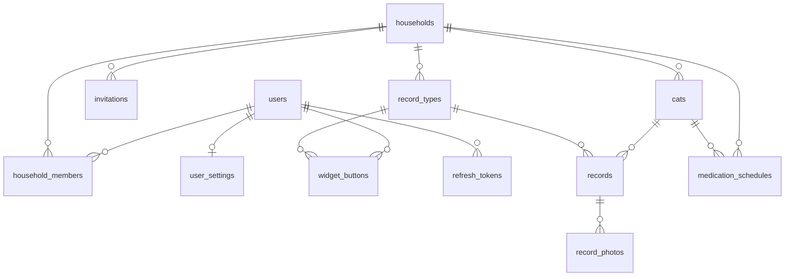

| 0.24 | 2026-11-12 | メールの送り方が決まった（Gmail の SMTP。メールアドレスの扱いは変わらない）ので、見直しの注記を消す |
# DB 設計書：MeowScope

| 項目 | 内容 |
|---|---|
| 文書番号 | 05 |
| 版数 | 0.24 |
| 作成日 | 2026-11-02 |
| 作成者 | major182 |
| 前提となる文書 | [01 要件定義書](01_requirements.md)、[02 技術選定書](02_tech-stack.md) |

---

## 1. 方針

- サーバーは PostgreSQL、端末は SQLite（drift）を使う。同期する表は、両方で同じ列を持つ
- ID は UUID で、端末でも作れるようにする
- 時刻はサーバーでは UTC の `timestamptz` で保存する

## 2. 同期する表の共通の列

| 列 | 型 | 説明 |
|---|---|---|
| `id` | uuid | 主キー。端末で作る |
| `created_at` | timestamptz | 作成日時 |
| `updated_at` | timestamptz | 更新日時。表示と記録のためで、競合の解決には使わない |
| `deleted_at` | timestamptz | 削除の印。空なら有効（BR-11） |
| `server_seq` | bigint | サーバーが変更を受け取るたびに振る通し番号。差分の取得と、競合の解決（後から受け取った変更を採用。BR-10）に使う。番号を振る処理はロックで1つずつ行い、確定（コミット）の順と番号の順をそろえる（V7 のトリガー `sync_assign_seq`） |

端末の時計に頼らないよう、`server_seq` は端末では作らない。競合は、サーバーが後から受け取った変更で上書きする（BR-10）。

## 3. ER 図

## 4. 同期する表

サーバーの表を正とし、端末は同期で受け取って持つ。ただし `users` と `user_settings` は端末に表を作らない。`users` からは表示名とアイコンの有無を受け取って `household_members` の行に書き、`user_settings` は `app_states` に置く（6章）。

### users（ユーザー）

| 列 | 型 | 制約 | 説明 |
|---|---|---|---|
| `email` | text | 一意（小文字で正規化） | サーバーのみ |
| `password_hash` | text | 必須 | サーバーのみ |
| `display_name` | text | 必須 | 表示名 |
| `icon_path` | text | | アイコンの場所（サーバーのみ）。端末は同期で有無（`hasIcon`）だけを受け取る |

### user_settings（ユーザーの設定）

| 列 | 型 | 制約 | 説明 |
|---|---|---|---|
| `user_id` | uuid | 一意 | ユーザー |
| `week_start` | text | 既定 `sunday` | 週の始まり |
| `reminder_hours` | integer | 既定10、1〜48、空はオフ | 記録忘れの n 時間（BR-13） |
| `notifications` | jsonb | | 通知の種類ごとのオンとオフ。`{"medication":true,"anomaly":true,"reminder":true,"family":true,"birthday":true}` の形で、ない種類はオンとみなす |
| `anomaly_method` | text | 既定 `statistical` | 判定方式（BR-20）。`statistical`（ふだんの傾向から自動）または `threshold`（自分で決めたしきい値） |

### households（おうち）

| 列 | 型 | 制約 | 説明 |
|---|---|---|---|
| `name` | text | 必須 | おうちの名前 |

### household_members（おうちのメンバー）

| 列 | 型 | 制約 | 説明 |
|---|---|---|---|
| `household_id` | uuid | 外部キー | おうち |
| `user_id` | uuid | 外部キー | ユーザー |
| `display_name` | text | | 端末のみ。メンバーの表示名を、同期で users から受け取って持つ |
| `has_icon`、`icon_seq` | boolean、integer | | 端末のみ。メンバーのアイコンの有無とその版（users の通し番号）。版が変わったら取り直す |

`household_id` と `user_id` の組は、有効な行の中で一意とする。退会した人の行は、相手の端末へ届くよう削除の印を付けて残し、`user_id` を空にする（ユーザーの削除で空になる）。

### cats（猫）

| 列 | 型 | 制約 | 説明 |
|---|---|---|---|
| `household_id` | uuid | 外部キー | おうち |
| `name` | text | 必須 | 名前 |
| `birth_date` | date | | 生年月日 |
| `sex` | text | | 性別 |
| `conditions` | text | | 持病 |
| `icon_path` | text | | アイコンの場所（サーバーのみ） |
| `has_icon` | boolean | 既定 false | 端末のみ。アイコンの有無（同期で受け取る）。版は猫の行の通し番号 |
| `status` | text | 既定 `active` | `active` または `farewell`（お別れ） |
| `anomaly_thresholds` | jsonb | | 猫ごとのしきい値（BR-20、S-47）。`{"food":{"min":1,"max":5},"weight":{"percent":5}}` の形で、キーは記録項目の種類（`food` `water` `urine` `stool` `vomit` `weight`）。端末では JSON の文字列で持つ（端末の DB の版 11 で追加）。古いアプリは送らないので、サーバーは送られてきたときだけ変える |

### record_types（記録項目）

| 列 | 型 | 制約 | 説明 |
|---|---|---|---|
| `household_id` | uuid | 外部キー | おうち |
| `name` | text | 必須 | 項目の名前 |
| `icon` | text | | アイコンのイラストの名前。標準の項目は種類で決まり、独自の項目は用意した一覧（`custom_vet` `custom_play` `custom_nail` `custom_teeth` `custom_treat` `custom_other`）から選ぶ |
| `kind` | text | 必須 | `food` `water` `medicine` `urine` `stool` `vomit` `weight` `brushing` `custom` |
| `sort_order` | integer | | 並び順 |
| `hidden` | boolean | 既定 false | 非表示（独自の項目だけ）。記録のボタンと選択に出さず、過去の記録は残す。記録項目は削除しない |

標準の8項目は、端末でおうちを作るときに端末で登録し、おうちの作成（`POST /households`）でサーバーへ送る。サーバーでは標準の項目を作らない。

### records（記録）

| 列 | 型 | 制約 | 説明 |
|---|---|---|---|
| `cat_id` | uuid | 外部キー | 猫 |
| `record_type_id` | uuid | 外部キー | 記録項目 |
| `recorded_at` | timestamptz | 必須 | 記録の日時 |
| `author_id` | uuid | 外部キー、削除時に空 | 投稿者（BR-17） |
| `author_name` | text | 必須 | 投稿時の投稿者名 |
| `value_number` | numeric | | 体重などの数値 |
| `level` | text | | 量。`little`（少し）`normal`（普通）`much`（多い） |
| `detail` | jsonb | | 項目ごとの追加情報 |
| `memo` | text | | 自由メモ |

索引：`(cat_id, recorded_at)`。端末でも同じ索引を作る。

### record_photos（写真）

| 列 | 型 | 制約 | 説明 |
|---|---|---|---|
| `record_id` | uuid | 外部キー | 記録 |
| `file_path` | text | | サーバーの保存場所（`<おうちの ID>/<写真の ID>`）。画像が送られるまでは空 |
| `size_bytes` | integer | | サイズ |
| `sort_order` | integer | 1〜3 | 表示順。1つの記録に3枚まで |
| `uploaded` | boolean | | 端末のみ。サーバーへ画像が送られたか（同期で受け取る） |

### widget_buttons（ウィジェットのボタン）

| 列 | 型 | 制約 | 説明 |
|---|---|---|---|
| `user_id` | uuid | 外部キー | ユーザー |
| `record_type_id` | uuid | 外部キー | 記録項目 |
| `sort_order` | integer | 0〜3 | 並び順。1人4つまで（S-44、BR-22） |

ボタンはアカウントのもので、端末にも同じ形で置き、同期で送受信する（BR-22）。記録項目はおうちのものなので、端末は今のおうちの項目のボタンだけを使う。おうちのデータを端末から消すときは、そのおうちの項目のボタンも消す。

### medication_schedules（お薬の予定）

| 列 | 型 | 制約 | 説明 |
|---|---|---|---|
| `household_id` | uuid | 外部キー | おうち |
| `cat_id` | uuid | 外部キー（猫の削除で消える） | 猫 |
| `name` | text | 必須、20文字まで | 薬の名前 |
| `dose` | text | 20文字まで | 量（例：1錠） |
| `time_of_day` | text | 必須、`HH:mm`（00:00〜23:59） | 毎日の時刻（端末の時刻＝日本時間） |
| `enabled` | boolean | 既定 true | オン・オフ |

予定はおうちのもので、家族と共有する（S-50、BR-06）。通知を出すかは各自の `user_settings.notifications` に従う。

## 5. サーバーだけの表

### invitations（招待）

| 列 | 型 | 説明 |
|---|---|---|
| `id` | uuid | 主キー |
| `household_id` | uuid | おうち |
| `token_hash` | text | トークンのハッシュ |
| `expires_at` | timestamptz | 有効期限 |
| `used_at` | timestamptz | 使用した日時 |

### refresh_tokens（ログインの更新トークン）

| 列 | 型 | 説明 |
|---|---|---|
| `id` | uuid | 主キー |
| `user_id` | uuid | ユーザー |
| `token_hash` | text | トークンのハッシュ |
| `expires_at` | timestamptz | 有効期限 |
| `revoked_at` | timestamptz | 無効にした日時 |

### sync_purges（完全に消した行の位置）

| 列 | 型 | 説明 |
|---|---|---|
| `id` | integer | 主キー。1行だけ（常に 1） |
| `purged_seq` | bigint | 行を完全に消したときに振った通し番号 |
| `purged_at` | timestamptz | 最後に消した日時 |

### password_resets（パスワードの再設定の確認コード）

| 列 | 型 | 説明 |
|---|---|---|
| `user_id` | uuid | 主キー。ユーザー（1人に1つ。送り直すと置き換える） |
| `code_hash` | text | 確認コードのハッシュ（ユーザーの ID を混ぜた SHA-256） |
| `expires_at` | timestamptz | 有効期限（作ってから15分） |
| `attempts` | integer | 間違えた回数。5回で使えなくする |
| `created_at` | timestamptz | 作った日時（送り直しの間隔に使う） |

## 6. 端末だけの表

| 表 | 主な列 | 説明 |
|---|---|---|
| `pending_changes` | ユーザーの ID、表の名前、行の ID、操作（`create`：おうちの作成で `POST /households` へ送る、`upsert`、`delete`）、変更の内容、失敗の回数 | 同期待ちの変更。失敗の回数は記録のためだけに持ち、再送の打ち切りや表示には使わない |
| `pending_photos` | ユーザーの ID、写真の ID、端末のファイルの場所 | 送信待ちの写真 |
| `local_photos` | 写真の ID、端末のファイルの場所、保存日時 | 30日で消す写真の管理 |
| `rejected_changes` | ユーザーの ID、表の名前、行の ID、理由、項目、日時 | サーバーが受け付けなかった変更。同じ行は1件にし、新しい理由で置き換える。送れたら消す。S-48 に出す |
| `client_logs` | 通し番号、重大度、文、日時、問い合わせ番号 | 端末のログ。同期のときにサーバーへ送り、送れたら消す。最新の1000件まで（ログ設計書 8章） |
| `app_states` | キー、値 | 端末の状態。同期の位置（`sync.lastSeq.<ユーザーの ID>`）、最終同期時刻、最後の問い合わせ番号（`sync.*`）。ログイン中のユーザーと選んでいるおうち（`session.*`）、ユーザーごとに最後に選んだおうち（`household.<ユーザーの ID>`。ログアウトしても残し、同じ人が入り直したら戻す）。トークンはここに置かず、OS の安全な保管場所に置く（NF-SC-07）。週の始まり（`settings.weekStart`）、記録忘れの時間（`settings.reminderHours`。空の文字はオフ）、通知の種類ごとのオン・オフ（`settings.notifications`。JSON）、判定方式（`settings.anomalyMethod`）もここに置き、同期で `user_settings` と送受信する。いつもとの差の通知を出した日（`notify.anomaly.<猫の ID>.<種類>`。同じ内容を1日1回にする。BR-12）も置く |

## 7. 削除の扱い

| 操作 | 動作 |
|---|---|
| 記録の削除 | `deleted_at` を入れて同期する。写真の本体は同期後に消す |
| 猫の削除 | 猫と記録と写真に `deleted_at` を入れる |
| おうちを抜ける（残す） | メンバーの行と、そのおうちの項目の本人のウィジェットのボタンに `deleted_at` を入れる |
| おうちを抜ける（消す） | 上に加えて、本人の投稿に `deleted_at` を入れる |
| 退会（残す） | `author_id` を空にし、`author_name` を残して、ユーザーを物理削除する |
| 退会（消す） | 本人の投稿に `deleted_at` を入れ、ユーザーを物理削除する |
| 最後の1人が抜ける | おうちとその中のデータをすべて物理削除し、`sync_purges` を進める |

`deleted_at` の入った行は、90日後に物理削除する。サーバーが毎日3時（日本時間）に、参照する側から（写真 → 記録 → ウィジェットのボタン → 記録項目 → 猫 → おうちのメンバー → おうち）消す。写真は画像のファイルも消す（ファイルは DB の確定の後に消し、取り消したら残す。ほかの削除でも同じ）。全体を1つのトランザクションで行う。期限が切れて90日を過ぎたログインのトークン・招待と、期限の切れた確認コードも片付ける。

物理削除したら、新しい通し番号を `sync_purges` に残し、それより前の位置から同期してきた端末には全件を取り直させる（消えた行の削除は差分では届かないため。親と一緒に消えた子の行もあるので、消した行の番号ではなく新しい番号にする）。親と一緒に消える子の行の写真・猫のアイコンのファイルも消す。端末は全件を取り直し終えたら、受け取らなかった行を消す（API 設計書 5章）。削除したデータの復元には対応しない（BR-29）。

## 8. 改訂履歴

| 版数 | 日付 | 内容 |
|---|---|---|
| 0.1 | 2026-11-02 | 初版 |
| 0.2 | 2026-11-02 | 未送信の表にユーザーの ID を追加 |
| 0.3 | 2026-11-02 | しきい値を猫の表へ移動 |
| 0.4 | 2026-11-03 | 標準の項目にブラッシングを追加、アイコンの持ち方を記入 |
| 0.5 | 2026-11-03 | 量（level）の値を記入 |
| 0.6 | 2026-11-03 | 端末の状態の表（app_states）を記入 |
| 0.7 | 2026-11-03 | 独自の項目のアイコンの値を記入 |
| 0.8 | 2026-11-03 | 独自の項目のアイコンの値を、届いたイラストに合わせて変更 |
| 0.9 | 2026-11-03 | 記録項目に hidden（非表示）を追加 |
| 0.10 | 2026-11-03 | 競合の解決をサーバーが受け取った順に変更。標準の8項目は端末で作ることを記入 |
| 0.11 | 2026-11-03 | 端末の状態の表にユーザーごとのおうちを追加。端末の DB の版 3 で、認証の前のデータを消す |
| 0.12 | 2026-11-03 | 同期の実装に合わせ、端末のメンバーの表示名と同期の状態の置き場所（app_states）を記入。sync_state の表は作らない |
| 0.13 | 2026-11-03 | 写真の保存場所を送信まで空にできるよう変更、端末の送信済みの印を追加 |
| 0.14 | 2026-11-03 | 退会した人のメンバーの行を残し、ユーザーの ID を空にする形に変更 |
| 0.15 | 2026-11-03 | アイコンの持ち方（サーバーは場所、端末は有無と版）を記入 |
| 0.16 | 2026-11-04 | ウィジェットのボタンの上限と、端末での持ち方を記入 |
| 0.17 | 2026-11-05 | 端末だけの表に送れなかった変更（rejected_changes）を追加 |
| 0.18 | 2026-11-05 | サーバーだけの表にパスワードの再設定の確認コード（password_resets）を追加 |
| 0.19 | 2026-11-05 | 削除から90日を過ぎた行の物理削除を実装（7章）、sync_purges を追加 |
| 0.20 | 2026-11-06 | 通し番号を確定の順に振ること（V7）、抜けるときのウィジェットのボタン、最後の1人と片付けの後の `sync_purges` を追加。画像のファイルは確定の後に消すこと、片付けを1つのトランザクションで行うことを追加 |
| 0.21 | 2026-11-06 | 4章を「同期する表」にし、端末に表を作らない users・user_settings の扱い、アイコンの列、記録項目とウィジェットのボタンの並び順の取り違え、同期待ちの操作、端末のログの表を直す（品質チェック） |
| 0.22 | 2026-11-06 | お薬の予定（medication_schedules）を追加。user_settings の通知の設定と判定方式、cats のしきい値の形、端末の app_states の通知の設定と通知を出した日のキーを記入 |
| 0.23 | 2026-11-06 | 端末の cats にしきい値の列（版 11）。サーバーは送られたときだけしきい値を変える |
