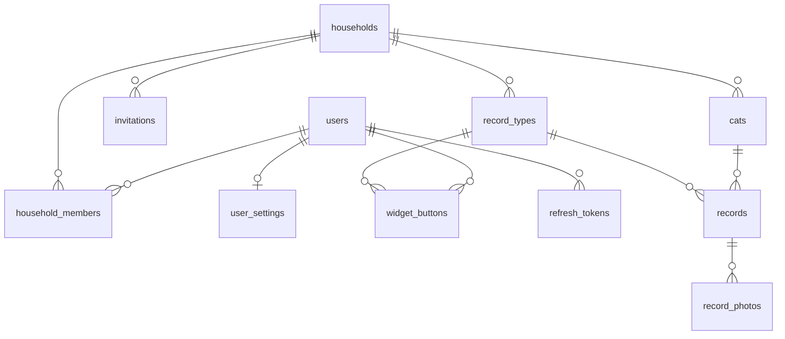

# DB 設計書：MeowScope

| 項目 | 内容 |
|---|---|
| 文書番号 | 05 |
| 版数 | 0.15 |
| 作成日 | 2026-11-02 |
| 作成者 | major182 |
| 前提となる文書 | [01 要件定義書](01_requirements.md)、[02 技術選定書](02_tech-stack.md) |

---

## 1. 方針

- サーバーは PostgreSQL、端末は SQLite（drift）を使う。同期する表は、両方で同じ列を持つ
- ID は UUID で、端末でも作れるようにする
- 時刻はサーバーでは UTC の `timestamptz` で保存する
- メールアドレスの扱いは Q-26 の結果で見直す可能性がある

## 2. 同期する表の共通の列

| 列 | 型 | 説明 |
|---|---|---|
| `id` | uuid | 主キー。端末で作る |
| `created_at` | timestamptz | 作成日時 |
| `updated_at` | timestamptz | 更新日時。表示と記録のためで、競合の解決には使わない |
| `deleted_at` | timestamptz | 削除の印。空なら有効（BR-11） |
| `server_seq` | bigint | サーバーが変更を受け取るたびに振る通し番号。差分の取得と、競合の解決（後から受け取った変更を採用。BR-10）に使う |

端末の時計に頼らないよう、`server_seq` は端末では作らない。競合は、サーバーが後から受け取った変更で上書きする（BR-10）。

## 3. ER 図

## 4. サーバーと端末の両方に持つ表

### users（ユーザー）

| 列 | 型 | 制約 | 説明 |
|---|---|---|---|
| `email` | text | 一意（小文字で正規化） | サーバーのみ |
| `password_hash` | text | 必須 | サーバーのみ |
| `display_name` | text | 必須 | 表示名 |
| `icon_path` | text | | アイコンの場所（サーバーのみ）。端末は同期で有無（`hasIcon`）だけを受け取る |

### user_settings（ユーザーの設定）

| 列 | 型 | 制約 | 説明 |
|---|---|---|---|
| `user_id` | uuid | 一意 | ユーザー |
| `week_start` | text | 既定 `sunday` | 週の始まり |
| `reminder_hours` | integer | 既定10、空はオフ | 記録忘れの n 時間 |
| `notifications` | jsonb | | 通知の種類ごとのオンとオフ |
| `anomaly_method` | text | 既定 `statistical` | 判定方式（BR-20） |

### households（おうち）

| 列 | 型 | 制約 | 説明 |
|---|---|---|---|
| `name` | text | 必須 | おうちの名前 |

### household_members（おうちのメンバー）

| 列 | 型 | 制約 | 説明 |
|---|---|---|---|
| `household_id` | uuid | 外部キー | おうち |
| `user_id` | uuid | 外部キー | ユーザー |
| `display_name` | text | | 端末のみ。メンバーの表示名を、同期で users から受け取って持つ |

`household_id` と `user_id` の組は、有効な行の中で一意とする。退会した人の行は、相手の端末へ届くよう削除の印を付けて残し、`user_id` を空にする（ユーザーの削除で空になる）。

### cats（猫）

| 列 | 型 | 制約 | 説明 |
|---|---|---|---|
| `household_id` | uuid | 外部キー | おうち |
| `name` | text | 必須 | 名前 |
| `birth_date` | date | | 生年月日 |
| `sex` | text | | 性別 |
| `conditions` | text | | 持病 |
| `icon_path` | text | | アイコンの場所 |
| `status` | text | 既定 `active` | `active` または `farewell`（お別れ） |
| `anomaly_thresholds` | jsonb | | 猫ごとのしきい値（BR-20） |

### record_types（記録項目）

| 列 | 型 | 制約 | 説明 |
|---|---|---|---|
| `household_id` | uuid | 外部キー | おうち |
| `name` | text | 必須 | 項目の名前 |
| `icon` | text | | アイコンのイラストの名前。標準の項目は種類で決まり、独自の項目は用意した一覧（`custom_vet` `custom_play` `custom_nail` `custom_teeth` `custom_treat` `custom_other`）から選ぶ |
| `kind` | text | 必須 | `food` `water` `medicine` `urine` `stool` `vomit` `weight` `brushing` `custom` |
| `sort_order` | integer | | 並び順 |
| `hidden` | boolean | 既定 false | 非表示（独自の項目だけ）。記録のボタンと選択に出さず、過去の記録は残す。記録項目は削除しない |

標準の8項目は、端末でおうちを作るときに端末で登録し、おうちの作成（`POST /households`）でサーバーへ送る。サーバーでは標準の項目を作らない。

### records（記録）

| 列 | 型 | 制約 | 説明 |
|---|---|---|---|
| `cat_id` | uuid | 外部キー | 猫 |
| `record_type_id` | uuid | 外部キー | 記録項目 |
| `recorded_at` | timestamptz | 必須 | 記録の日時 |
| `author_id` | uuid | 外部キー、削除時に空 | 投稿者（BR-17） |
| `author_name` | text | 必須 | 投稿時の投稿者名 |
| `value_number` | numeric | | 体重などの数値 |
| `level` | text | | 量。`little`（少し）`normal`（普通）`much`（多い） |
| `detail` | jsonb | | 項目ごとの追加情報 |
| `memo` | text | | 自由メモ |

索引：`(cat_id, recorded_at)`。端末でも同じ索引を作る。

### record_photos（写真）

| 列 | 型 | 制約 | 説明 |
|---|---|---|---|
| `record_id` | uuid | 外部キー | 記録 |
| `file_path` | text | | サーバーの保存場所（`<おうちの ID>/<写真の ID>`）。画像が送られるまでは空 |
| `size_bytes` | integer | | サイズ |
| `sort_order` | integer | 1〜3 | 表示順。1つの記録に3枚まで |
| `uploaded` | boolean | | 端末のみ。サーバーへ画像が送られたか（同期で受け取る） |

### widget_buttons（ウィジェットのボタン）

| 列 | 型 | 制約 | 説明 |
|---|---|---|---|
| `user_id` | uuid | 外部キー | ユーザー |
| `record_type_id` | uuid | 外部キー | 記録項目 |
| `sort_order` | integer | | 並び順 |

## 5. サーバーだけの表

### invitations（招待）

| 列 | 型 | 説明 |
|---|---|---|
| `id` | uuid | 主キー |
| `household_id` | uuid | おうち |
| `token_hash` | text | トークンのハッシュ |
| `expires_at` | timestamptz | 有効期限 |
| `used_at` | timestamptz | 使用した日時 |

### refresh_tokens（ログインの更新トークン）

| 列 | 型 | 説明 |
|---|---|---|
| `id` | uuid | 主キー |
| `user_id` | uuid | ユーザー |
| `token_hash` | text | トークンのハッシュ |
| `expires_at` | timestamptz | 有効期限 |
| `revoked_at` | timestamptz | 無効にした日時 |

## 6. 端末だけの表

| 表 | 主な列 | 説明 |
|---|---|---|
| `pending_changes` | ユーザーの ID、表の名前、行の ID、操作、変更の内容、試行回数 | 同期待ちの変更 |
| `pending_photos` | ユーザーの ID、写真の ID、端末のファイルの場所 | 送信待ちの写真 |
| `local_photos` | 写真の ID、端末のファイルの場所、保存日時 | 30日で消す写真の管理 |
| `app_states` | キー、値 | 端末の状態。同期の位置（`sync.lastSeq.<ユーザーの ID>`）、最終同期時刻、受け付けられなかった件数、最後の問い合わせ番号（`sync.*`）。ログイン中のユーザーと選んでいるおうち（`session.*`）、ユーザーごとに最後に選んだおうち（`household.<ユーザーの ID>`。ログアウトしても残し、同じ人が入り直したら戻す）。トークンはここに置かず、OS の安全な保管場所に置く（NF-SC-07）。週の始まり（`settings.weekStart`）もここに置き、同期で `user_settings` と送受信する |

## 7. 削除の扱い

| 操作 | 動作 |
|---|---|
| 記録の削除 | `deleted_at` を入れて同期する。写真の本体は同期後に消す |
| 猫の削除 | 猫と記録と写真に `deleted_at` を入れる |
| おうちを抜ける（残す） | メンバーの行に `deleted_at` を入れる |
| おうちを抜ける（消す） | 上に加えて、本人の投稿に `deleted_at` を入れる |
| 退会（残す） | `author_id` を空にし、`author_name` を残して、ユーザーを物理削除する |
| 退会（消す） | 本人の投稿に `deleted_at` を入れ、ユーザーを物理削除する |
| 最後の1人が抜ける | おうちとその中のデータをすべて物理削除する |

`deleted_at` の入った行は、90日後に物理削除する。（未実装。デプロイの前に作る）90日より長く同期しなかった端末は、全件を取得し直す。削除したデータの復元には対応しない（BR-29）。

## 8. 改訂履歴

| 版数 | 日付 | 内容 |
|---|---|---|
| 0.1 | 2026-11-02 | 初版 |
| 0.2 | 2026-11-02 | 未送信の表にユーザーの ID を追加 |
| 0.3 | 2026-11-02 | しきい値を猫の表へ移動 |
| 0.4 | 2026-11-03 | 標準の項目にブラッシングを追加、アイコンの持ち方を記入 |
| 0.5 | 2026-11-03 | 量（level）の値を記入 |
| 0.6 | 2026-11-03 | 端末の状態の表（app_states）を記入 |
| 0.7 | 2026-11-03 | 独自の項目のアイコンの値を記入 |
| 0.8 | 2026-11-03 | 独自の項目のアイコンの値を、届いたイラストに合わせて変更 |
| 0.9 | 2026-11-03 | 記録項目に hidden（非表示）を追加 |
| 0.10 | 2026-11-03 | 競合の解決をサーバーが受け取った順に変更。標準の8項目は端末で作ることを記入 |
| 0.11 | 2026-11-03 | 端末の状態の表にユーザーごとのおうちを追加。端末の DB の版 3 で、認証の前のデータを消す |
| 0.12 | 2026-11-03 | 同期の実装に合わせ、端末のメンバーの表示名と同期の状態の置き場所（app_states）を記入。sync_state の表は作らない |
| 0.13 | 2026-11-03 | 写真の保存場所を送信まで空にできるよう変更、端末の送信済みの印を追加 |
| 0.14 | 2026-11-03 | 退会した人のメンバーの行を残し、ユーザーの ID を空にする形に変更 |
| 0.15 | 2026-11-03 | アイコンの持ち方（サーバーは場所、端末は有無と版）を記入 |
