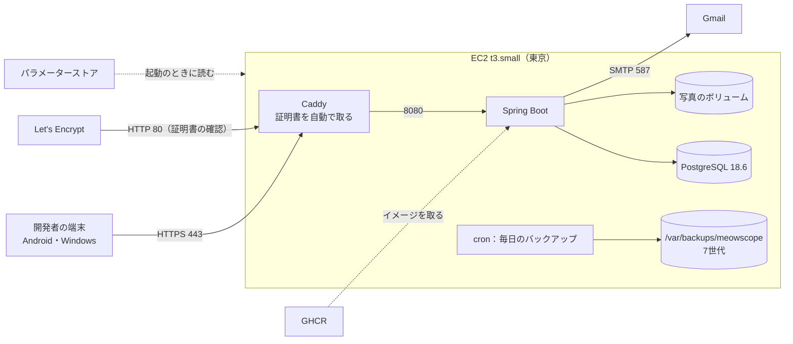
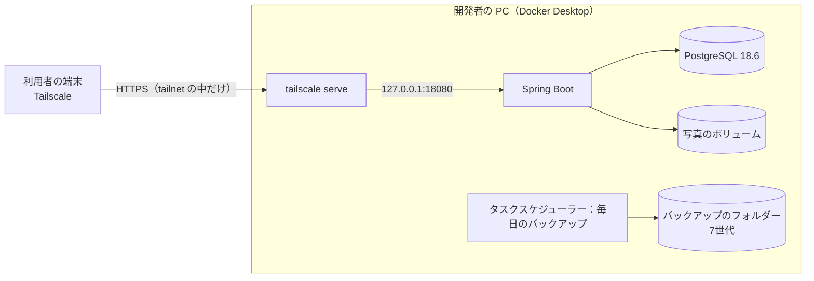
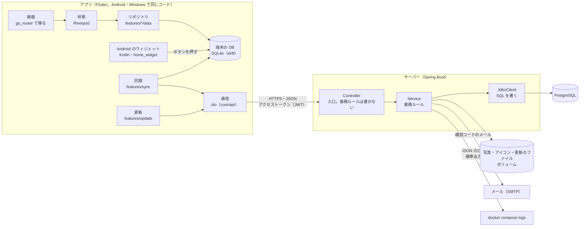
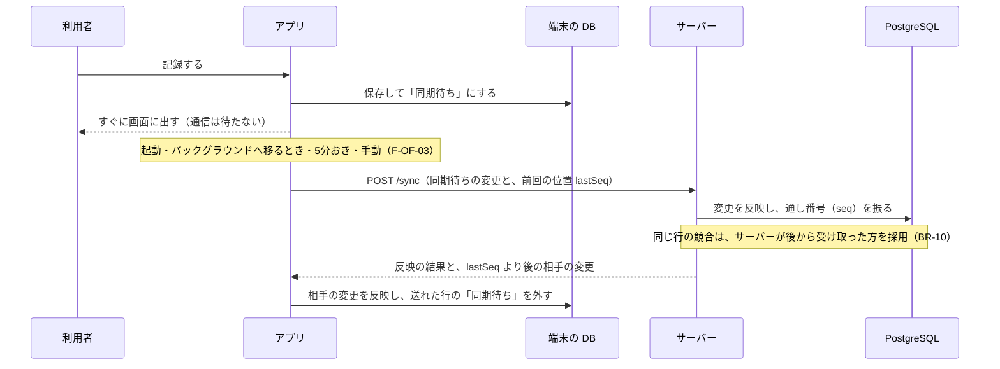

# デプロイ設計書：MeowScope

| 項目 | 内容 |
|---|---|
| 文書番号 | 09 |
| 版数 | 0.15 |
| 作成日 | 2026-11-11 |
| 作成者 | major182 |
| 前提となる文書 | [01 要件定義書](01_requirements.md)、[02 技術選定書](02_tech-stack.md)、[07 ログ設計書](07_logging-design.md)、[08 性能テスト設計書](08_performance-test.md) |

サーバーを AWS に置いて動作を確かめ（C-04）、その後に開発者の PC の Docker へ移す（C-05・C-08）。そのための構成・費用・手順・バックアップ・アプリの配り方を書く。

アカウント ID・ARN・インスタンス ID・IP アドレス・サーバーの URL・tailnet の名前・メールアドレスは、この文書に書かない。値の確かめ方を各章に書く。

---

## 1. 決めたこと

| 項目 | 決定 | 理由 |
|---|---|---|
| 進め方 | A. AWS に置く → B. PC へ移す → AWS を消す | 要件定義書 C-04・C-05 |
| AWS に置く期間 | 開始と終了は利用者が合図する（日数は決めない） | 課題の確認の日程に合わせる |
| AWS で使う人 | 開発者1人（Android と Windows） | ほかの利用者は PC へ移した後に使い始める |
| サーバー | EC2（t3.small）1台で、`compose.yaml` をそのまま動かす | 技術選定書。PC と同じ構成で移しやすい |
| HTTPS | Caddy 2.11.9 で証明書を自動で取る。名前は **sslip.io**（IP アドレスから名前を作る無料のサービス） | ドメインを買わずに正式な証明書を使える |
| サーバーへの入り方 | セッションマネージャーだけ。SSH は開けない | 鍵を持たず、受けるポートを減らす |
| サーバーのイメージ | GitHub Actions で作り、GitHub Container Registry（GHCR）に置く。EC2 は取ってくるだけ | t3.small（2GB）でのビルドはメモリーが足りないおそれがある。ECR や OIDC の設定も要らない |
| 秘密の値 | パラメーターストア（SecureString）。EC2 は起動のときに読んで、root だけが読める `.env` に書く | 鍵をリポジトリ・イメージに入れない |
| 自動デプロイ | 行わない。更新は手で1つのコマンド（5.3） | 使う期間が短く、使う人も1人 |
| バックアップ | 毎日 DB のダンプと写真を固め、7世代を残す（NF-BK-01）。AWS と PC で同じスクリプト | 4章 |
| PC での接続 | Tailscale の `tailscale serve` で、tailnet の中だけに HTTPS で出す | サーバーをインターネットに公開しない（C-08） |
| PC の本番と開発 | 同じ PC の Docker で、名前（本番 `meowscope`・開発 `meowscope-dev`）・ボリューム・ポートを分ける。本番は開発の作業フォルダーとは別のフォルダー（例：`C:\Major182\MeowScope`）に置く（6.3） | データが混ざらず、名前で見分けて取り違えて操作しない。開発のブランチの切り替えやビルドが本番に及ばない |
| PC の本番のサーバー | AWS と同じ GHCR のイメージを使う | 開発のビルドに左右されない。将来の一般公開で外部のサーバーへ戻すときも同じ形で済む |
| Android の配布 | 署名した APK を、開発者の手で端末に入れる | 一般公開しない。署名の鍵は PC の外に出さない |
| Windows の配布 | Inno Setup 6.7.3 でインストーラーにする。署名はしない（技術選定書 5章） | 署名がなくても作れる。SmartScreen の警告は「詳細情報」→「実行」で進める |
| 公開の範囲 | APK・インストーラーは GitHub Releases に置かない | サーバーの URL（IP アドレスや tailnet の名前）がアプリに入るため |

## 2. 構成

### 2.1 A. AWS

| 資源 | 内容 |
|---|---|
| VPC | 公開サブネット1つ。NAT ゲートウェイは使わない |
| セキュリティグループ | 受けるのは 80・443 だけ（どこからでも。スマートフォンは回線で IP が変わるため）。DB とサーバーの 8080 は外に出さない |
| EC2 | Amazon Linux 2023、t3.small、ディスク gp3 20GB（暗号化）。スワップ 2GB。IMDSv2 だけ |
| 固定の IP（Elastic IP） | sslip.io の名前と証明書が変わらないように固定する |
| IAM ロール | セッションマネージャー（`AmazonSSMManagedInstanceCore`）と、`/meowscope/*` のパラメーターを読む権限だけ |
| パラメーターストア | `/meowscope/db-password`・`/meowscope/jwt-secret`・`/meowscope/mail-username`・`/meowscope/mail-password`（どれも SecureString） |

`compose.yaml` に、AWS 用の差分 `deploy/compose.aws.yaml` を重ねる。

- `caddy` を足す（80・443 を受け、`server:8080` へ渡す。証明書はボリュームに残す）
- `server` の 8080 と `db` の 5432 は外に出さない
- `server` はイメージを GHCR から取る（`build` しない）。`MEOWSCOPE_ENV=prod`
- `MAIL_HOST=smtp.gmail.com`・`MAIL_PORT=587`

サーバーの URL は `https://<固定の IP をハイフンでつないだもの>.sslip.io/api/v1`。確かめ方は `terraform output api_base_url`。

### 2.2 B. PC

- `deploy/compose.pc.yaml` を重ね、サーバーを `127.0.0.1:18080` だけで受ける（LAN に出さない。開発用の 8080・5432 とぶつけない）。DB は外に出さない
- 本番のフォルダーの `.env` に `COMPOSE_PATH_SEPARATOR=;` と `COMPOSE_FILE=compose.yaml;deploy/compose.pc.yaml` を書き、そのフォルダーでは `docker compose` だけで本番を操作できるようにする（重ねるファイルの指定の付け忘れを起こさない）
- PC はサーバー専用ではなく普段使いの PC なので、スリープ・OS の更新による再起動・サインインの前は、サーバーが止まる。Docker Desktop の「サインインしたときに起動」をオンにし、コンテナは `restart: unless-stopped` で戻す。止まっている間もアプリは端末に記録し、動いたら同期する（F-OF-02）
- `tailscale serve` が tailnet の中だけに HTTPS で出す。証明書は Tailscale が用意する
- サーバーの URL は `https://<PC の名前>.<tailnet>.ts.net/api/v1`。確かめ方は `tailscale status`
- Tailscale のアクセス制御（管理画面の Access controls）で、メンバーの端末（`autogroup:member`）から **PC の 443 だけ**を許可する。許可がないと、ほかの端末から PC へは何もつながらない（同じ PC の Windows のアプリはつながるので気づきにくい）。PC は `hosts` に tailnet の IP で名前を付けて指す（例：`"hosts": {"meowscope-server": "<PC の tailnet の IP>"}` と、`"grants"` に `{"src": ["autogroup:member"], "dst": ["meowscope-server"], "ip": ["443"]}`）。IP は `tailscale ip -4` で確かめる
- PC に `tag:server` などのタグは付けない。タグを付けると PC の持ち主が利用者からタグに替わり、PC からほかの端末へつなげなくなるため、普段使いの PC に向かない（サーバー専用の機械を置くときはタグで指す）
- 利用者の端末に Tailscale を入れ、同じ tailnet に招く
- PC が止まっている間は、アプリは端末に記録し、PC が動いたら同期する（F-OF-02）

### 2.3 アプリとサーバーの中の作り

2.1・2.2 は「どこに置くか」の図。ここでは、どこに置いても同じ、アプリとサーバーの中の作りを示す。

| 部分 | 役割 | 詳しくは |
|---|---|---|
| 画面・状態 | 記録・猫などの共有データは、端末の DB から読む。通信を待たずに表示でき、オフラインでも使える（F-OF-01・02）。ログイン・招待・写真の取得などは、その場でサーバーに問い合わせる | 画面設計書 |
| 端末の DB | 記録・猫・設定などをまず端末に保存し、「同期待ち」の印を付ける | DB 設計書 |
| ウィジェット | ボタンを押すと、アプリを開かずに裏の処理（Dart）が端末の DB に記録する。送るのは次の同期 | 要件定義書 F-WG-01 |
| 同期 | 端末の変更を送り、相手の変更を受け取る。共有のデータは個別の API を作らず、すべて同期の API で送受信する | API 設計書 5章 |
| 更新 | 起動したときに新しい版を聞き、ファイルを取ってきて OS に渡す | API 設計書 10章、6.4 |
| サーバーの層 | Controller → Service → JdbcClient の3層。エラーは `ApiException` で投げ、Problem Details の形で返す | API 設計書 9章 |
| ログ | サーバーも端末も JSON のログ。端末の失敗はサーバーへ送り、問い合わせ番号で追える | ログ設計書 |

同期の流れ（API 設計書 5章）：

- 通信できない・サーバーが止まっているときは、同期待ちのまま残し、次の同期で送る（F-OF-02）
- 2つの端末が同じ行を変えても、端末の時計は使わず、サーバーが受け取った順で決める（BR-10）

## 3. 費用（A. AWS）

金額は USD で、概算。作る前に AWS の料金 API で確かめる。

| 項目 | 単価 | 1日 |
|---|---|---|
| EC2 t3.small（東京） | 約 $0.027／時 | 約 $0.65 |
| 公開 IPv4（Elastic IP） | $0.005／時 | $0.12 |
| EBS gp3 20GB | 約 $0.096／GB・月 | 約 $0.07 |
| パラメーターストア（標準）・通信 | ― | ほぼ 0 |
| **合計** | | **約 $0.85** |

- アカウントは無料プランで、費用はクレジットから引かれる。2026-11-11 の残高は $158.54、期限は 2027-03-27（`aws freetier get-account-plan-state` で確認）。t3.small は無料プランで使える種類（`aws ec2 describe-instance-types --filters Name=free-tier-eligible,Values=true`）
- 予算のアラートとコスト異常検出は、アカウント共通のものを使う。Terraform では作らず、消さない

## 4. バックアップ（F-BK-01、NF-BK-01）

`deploy/backup.sh` を AWS（cron）と PC（タスクスケジューラーから Git Bash）で動かす。

| 項目 | 内容 |
|---|---|
| 時刻 | 毎日 3:00（日本時間） |
| DB | `docker compose exec db pg_dump -Fc` で1つのファイルに |
| 写真 | 写真のボリュームを tar.gz に固める |
| 残す数 | 7世代。古いものから消す |
| 置き場所 | AWS：EC2 のディスクの `/var/backups/meowscope`。PC：C ドライブとは物理的に別のディスク（例：`G:\MeowScopeBackup`。パスはタスクの引数で渡し、リポジトリには書かない） |
| 失敗したとき | 終了コードと件数をログに残す（AWS は `/var/log/meowscope-backup.log`、PC は置き場所の `backup.log`）。途中で失敗したファイルは世代に数えない |
| PC が眠っていたとき | タスクスケジューラーの「スケジュールされた時刻にタスクを開始できなかった場合、すぐにタスクを実行する」をオンにし、起きた後に動かす。夜中に PC を起こさない。Docker が動いていなければ失敗をログに残し、次の回に任せる |
| 復元の確認 | 作った日に一度、別のコンテナの PostgreSQL に戻し、利用者・猫・記録の件数と写真の数が元と合うかを確かめる（`deploy/restore-check.sh`）。PC へ移すときの手順も、これと同じ |

- 置き場所は引数（`deploy/backup.sh <置き場所>`）か環境変数 `BACKUP_DIR` で渡す。AWS では EC2 の初期設定が cron（`/etc/cron.d/meowscope-backup`）を登録する。PC では、本番のフォルダーにあるスクリプトを動かす（`.env` の `COMPOSE_FILE` で本番を指すため。開発の作業フォルダーから動かすと開発用を固める）
- 2つのスクリプトは CI（`deploy` のジョブ）で、開発用の compose に対して動かして確かめる

AWS のバックアップは EC2 のディスクの中だけにある。AWS を使う期間は短く、PC へ移すときに最新のダンプを持ち出すので、別の場所への写しはしない。

## 5. 手順

### 5.1 準備（1回だけ）

1. サーバーのイメージを作る：GitHub Actions の `server-image` を手で動かし、`ghcr.io/major182/meowscope-server:<コミット>` を作る（公開のパッケージ。秘密の値は入っていない）
2. パラメーターストアに秘密の値を入れる。DB のパスワードと JWT の鍵はその場で作る。メールの値は手元の `.env` から入れ、画面に出さない
3. Android の署名の鍵を作る（6.1）

### 5.2 A. AWS を作る

1. `deploy/terraform` で `terraform apply -var image_tag=<イメージのコミット>`（VPC・EC2・Elastic IP・セキュリティグループ・IAM ロール）。状態のファイル（tfstate）は手元に置き、コミットしない
2. EC2 の初期設定（`deploy/terraform/user_data.sh.tftpl`）が、スワップを作り、Docker を入れ、リポジトリを取り、パラメーターから `.env` を作り、`docker compose up -d` まで行う
3. `terraform output api_base_url` の URL で、`/actuator/health` が `UP` を返すことを確かめる
4. その URL でアプリを作って入れる（6章）
5. 5.4 の確認を行う

- 初期設定は最初の起動のときだけ動く。`image_tag` を変えて `terraform apply` しても EC2 は作り直さない（DB がディスクの中にあるため）。イメージの更新は 5.3 で行う
- 定義の書式と、外に出すポートが 80・443 だけであることは CI（`deploy` のジョブ）で確かめる

### 5.3 更新

新しいイメージを作った後に、セッションマネージャーから `deploy/update.sh <コミット>` を動かす（イメージを取り直し、`docker compose up -d`）。DB の構造は、起動のときに Flyway が反映する。

### 5.4 確認すること

| 観点 | 内容 |
|---|---|
| 通信 | HTTP は HTTPS へ転送される。証明書が正しい。8080・5432 には外からつながらない |
| 認証 | 登録・ログイン・ログアウト・パスワードの再設定のメールが届く |
| 機能 | おうち・招待のリンク・記録・写真・カレンダー・統計・通知・Android のウィジェット |
| 同期 | Android と Windows の両方で記録し、互いに届く。機内モードで記録し、戻したら届く |
| ログ | `docker compose logs server` に JSON のログが出る。端末のログが届く |
| バックアップ | 翌朝にバックアップができている。復元の確認が通る |

### 5.5 B. PC へ移す

2つの段階に分ける。準備の間、アプリは AWS を使い続ける。

**準備（PC に本番を立てて確かめる）**

1. 開発用のコンテナを止め、名前を分ける前の古いボリューム（`meowscope_*`）を消す。残すと、本番が開発のデータを使ってしまう。開発用は `docker compose up -d` で `meowscope-dev` として立て直す（開発のデータは消えてよい）
2. 本番のフォルダーにリポジトリを取り、`.env` を作る（`COMPOSE_FILE`・`SERVER_IMAGE_TAG`・DB のパスワード・JWT の鍵・メール。AWS のパラメーターストアと同じ値にし、画面に出さない）。`SERVER_IMAGE_TAG` は AWS で動いている版（EC2 の `/opt/meowscope/.env`）と同じにする。DB の構造（Flyway）の版がそろい、戻したダンプがそのまま使える
3. AWS でバックアップを取り、PC に持ってくる（S3 は使わない）
   - セッションマネージャーのコマンドで、EC2 の `deploy/backup.sh` を動かし、最新の世代を一時フォルダーに写す。照らし合わせ用に、SHA-256 と、利用者・猫・記録の件数も取る
   - 同じく EC2 の中だけ（`127.0.0.1`）で、一時フォルダーを渡すサーバーを時間の制限つきで立てる（`timeout 600 python3 -m http.server <ポート> --bind 127.0.0.1`）
   - PC で `aws ssm start-session --document-name AWS-StartPortForwardingSession` でそのポートをつなぎ、ファイルを取る。SHA-256 が EC2 と合うことを確かめる
   - 取り終わったら、ポート転送と EC2 のサーバーを止め、一時フォルダーを消す
4. 本番を立て、ダンプと写真を戻す。件数が AWS と合うことを確かめる
   - DB だけを立て（`docker compose up -d --wait db`）、`pg_restore -U meowscope -d meowscope --no-owner --exit-on-error` で戻す。その後にサーバーを立てる（Flyway は確かめるだけで、何も変えない）
   - 写真は `docker compose exec -T -u root server tar xzf - -C /data/photos` で戻し、**持ち主をサーバーの利用者に直す**（`chown -R 10001 /data/photos`）。root で展開すると tar に記録された持ち主のままになり、サーバーが写真を保存できなくなる
5. タスクスケジューラーにバックアップを登録し、できたバックアップで復元の確認（`deploy/restore-check.sh`）を通す
   - 動かすもの：Git Bash で `cd <本番のフォルダー> && bash deploy/backup.sh <置き場所> >> <置き場所>/backup.log 2>&1`
   - 設定：毎日 3:00、「ユーザーがログオンしているときのみ実行する」（Docker Desktop もサインインの後に動くため。パスワードを預けない）、「スケジュールされた時刻にタスクを開始できなかった場合、すぐにタスクを実行する」
6. Docker Desktop の「Start Docker Desktop when you sign in to your computer」をオンにする（再起動の後に本番を戻すため）

**切り替え（VPN）**

1. PC に Tailscale を入れ、`tailscale serve --bg --https=443 http://127.0.0.1:18080` で tailnet の中へ出す（`--bg` で再起動の後も残る）。管理画面のアクセス制御で、メンバーの端末から PC の 443 を許可する（2.2）
   - 確かめ方：ほかの端末のブラウザーで `https://<PC の名前>.<tailnet>.ts.net/actuator/health` を開く。Chrome は応答の形式（`application/vnd.spring-boot.actuator.v3+json`）を表示できず、`health.bin` のダウンロードになるが、それでつながっている
   - 時間切れになるときは、PC で `tailscale debug netmap` の `PacketFilter` を見る。空（`[]`）なら、アクセス制御で PC への許可がない
2. AWS の最新のバックアップを取り直し、本番に戻し直す（準備の後に記録した分を含めるため）。本番のフォルダーで `docker compose down -v` で本番のボリュームを空にしてから、準備の 3・4 と同じ手順で戻す。取り直す前に、アプリで記録しないよう利用者に伝える
3. PC の URL でアプリを作り直し、入れ直す（同じ署名の鍵なので、端末のデータは残る）
4. 利用者の端末に Tailscale とアプリを入れる
5. 数日使って問題がなければ、7章で AWS を消す

## 6. アプリの配り方

### 6.1 Android

- 署名の鍵は `keytool` で作り、リポジトリの外（`%USERPROFILE%\.meowscope\`）に置く。鍵のパスワードは利用者のパスワードの管理の道具に残す。鍵をなくすと、同じアプリとして上書きできなくなる
- `app/android/key.properties`（`.gitignore` に入っている）で鍵の場所を渡し、`build.gradle.kts` は、それがあれば release の署名に使う（なければ今のとおり debug の鍵）。中身は `storeFile`（鍵のファイルの場所）・`storePassword`・`keyAlias`・`keyPassword` の4行
- 署名の確かめ方：`apksigner verify --print-certs build/app/outputs/flutter-apk/app-release.apk`（Android SDK の build-tools にある）
- `flutter build apk --release --dart-define=API_BASE_URL=<サーバーの URL>`
- `adb install -r` か、ファイルを端末に送って入れる

### 6.2 Windows

- `flutter build windows --release --dart-define=API_BASE_URL=<サーバーの URL>`
- Inno Setup のスクリプト（`app/windows/installer/meowscope.iss`）で、`build/windows/x64/runner/Release` をインストーラー（`app/build/installer/MeowScope-Setup-<版>.exe`）にする。`app` のフォルダーで `ISCC.exe /DAppVersion=<pubspec.yaml の版> windows\installer\meowscope.iss`
- 管理者の権限なしで、使う人のフォルダー（`%LOCALAPPDATA%\Programs\MeowScope`）に入れる。スタートメニューに登録し、アンインストールもできる
- Inno Setup は `winget install JRSoftware.InnoSetup --version 6.7.3 --scope user` で入れる
- 署名はしない（技術選定書 5章）。初めて動かすときの SmartScreen の警告は「詳細情報」→「実行」で進める

### 6.3 開発版と配布版を分ける

開発版と配布版は保存先を分け、同じ PC・端末で混ざらないようにする。名前を足すのは開発側だけで、配布版は元の名前のまま。ビルドの種類で決まるので、作るときに指定は要らない。

| 項目 | 配布版（release） | 開発版（debug・profile） |
|---|---|---|
| Windows のアプリ名（保存先を決める） | `meowscope`（`%APPDATA%\com.meowscope\meowscope`） | `meowscope-dev`（`%APPDATA%\com.meowscope\meowscope-dev`） |
| Windows のウィンドウの名前 | MeowScope | MeowScope Dev |
| Android のアプリの ID | `com.meowscope.meowscope` | `com.meowscope.meowscope.dev` |
| Android のホーム画面の名前 | MeowScope | MeowScope Dev |
| PC の Docker の名前（コンテナ・ボリュームの頭に付く） | `meowscope`（`deploy/compose.pc.yaml`・`compose.aws.yaml` で上書き） | `meowscope-dev`（`compose.yaml` のまま） |
| PC の Docker の置き場所 | 本番のフォルダー（例：`C:\Major182\MeowScope`） | 開発の作業フォルダー |
| PC のサーバーのポート | `127.0.0.1:18080`（DB は出さない） | 8080・DB は `127.0.0.1:5432` |

- Windows の記録の DB も、アプリ名で分かれる保存先に置く（drift の既定の「ドキュメント」には置かない）。ログインの情報と写真も同じ保存先にある
- Android は別のアプリになるので、1台の端末に両方を入れられる
- 撮影など、開発版を速く動かしたいときは profile で動かす（release は配布版になる）
- Windows の開発版のインストーラーは、`flutter build windows --profile` の後に `ISCC.exe /DDev /DAppVersion=<版> windows\installer\meowscope.iss` で作る。別の AppId・名前「MeowScope Dev」・別のフォルダー（`%LOCALAPPDATA%\Programs\MeowScope Dev`）になり、配布版を上書きしない。アプリの更新（6.4）を開発版で確かめるときに使う

### 6.4 アプリの更新を出す（Ver.1.1）

アプリは起動のときにサーバーへ新しい版を聞き、利用者が選んだら取ってきて入れる（要件定義書 F-UP-01〜02、API 設計書 10章）。開発者は、新しい版をサーバーの決まったフォルダーに置く。

| 項目 | 内容 |
|---|---|
| 版の番号 | `app/pubspec.yaml` の `version` を上げる。ビルド番号（`+` の後）は出すたびに必ず1つ上げる（BR-34）。上げ方は BR-34（SemVer）に従い、要件定義書 2章のリリースの段階の番号にする |
| 作るもの | 6.1 の APK と 6.2 のインストーラー（サーバーの URL と版の番号が入る） |
| 版の情報 | `release.json`（`version`・`buildNumber`・`sha256`・`sizeBytes`）。作るときにスクリプトが計算する |
| 置き場所 | サーバーのボリューム `releases-data`（`/data/releases/<android か windows>/`）。ファイルの名前は `meowscope.apk`・`meowscope-setup.exe`（API 設計書 10章）。開発（`bootRun`）では `server/data/releases/`。版の情報とファイルを1組だけ置き、新しい版で上書きする |
| AWS へ届け方 | SSH を開けないので、非公開の S3 バケットを中継にする。手元から S3 に上げ、セッションマネージャーで EC2 に取らせてボリュームへ置く。バケットは Terraform で作り、EC2 のロールには読み取りだけを許す。`terraform destroy` で中身ごと消す |
| PC へ届け方 | `docker compose cp` で本番（名前 `meowscope`）のボリュームへ置く。開発の作業フォルダーから動かすので、`-p meowscope` で本番を名前で指す |
| 入れ方 | Android は OS のインストールの画面（REQUEST_INSTALL_PACKAGES、FileProvider）。Windows はインストーラーを `/VERYSILENT /SUPPRESSMSGBOXES /NORESTART /CLOSEAPPLICATIONS` で動かし、`meowscope.iss` の `[Run]`（`skipifnotsilent`）で開き直す |

手順（Git Bash で、リポジトリの直下から）：

0. 初めて AWS に出すときは、`terraform apply` で中継の S3 バケットと EC2 の読み取り権限を足す（EC2 は作り直さない。引数は 5.2 と同じ）
1. `app/pubspec.yaml` の `version` を上げてコミットする（例：`1.1.0+5` → `1.1.1+6`）
2. 開発版で更新の流れを確かめる：開発版を開発用のサーバーに置く（`deploy/place-release.sh android <release.json とファイルのフォルダー>`）
3. 配布版を作って置く：`CONTACT_EMAIL=<問い合わせ先> deploy/publish-release.sh <android か windows> <aws か pc>`。`pc` のときは `API_BASE_URL` も渡す。Windows は、ビルドの間だけ開発者モードをオンにする
4. スクリプトは、作る → `release.json` を作る → 置く → サーバーから見えるファイルの SHA-256 が合うかを確かめる、まで行い、手元と S3 の中継のファイルを消す。最後に、アプリの設定の「更新を確かめる」で新しい版が知らされることを確かめる

| スクリプト | 動かす所 | 内容 |
|---|---|---|
| `deploy/publish-release.sh` | 手元の PC | 配布版を作り、版の情報を作り、AWS（S3 → セッションマネージャー）か手元の Docker に置く。バケットの名前や EC2 の ID は `terraform output` から読み、画面に出さない |
| `deploy/place-release.sh` | サーバーの動く所（EC2・PC） | ファイルを別名で置いてから名前を替え、最後に版の情報を置き換える（端末が新しい版の情報で古いファイルを取らないように）。置いた後に SHA-256 を確かめる |

- S3 の中継は外から読めず、置き終わったら消す。消し忘れても1日で消える（ライフサイクルの設定）
- 置く前に、開発版で更新の流れを確かめる（配布版の端末で試さない）
- 古い版は残さない（1組だけ）。戻したいときは、前の版の番号を上げて作り直して出す

## 7. 片付け（AWS）

1. 最新のバックアップを PC に持ってきてあることを確かめる
2. `terraform destroy` で全部消す
3. EC2・EBS・Elastic IP・セキュリティグループ・IAM ロール・パラメーター・更新の中継の S3 バケットの消し残しが 0 件であることを CLI で確かめる
4. 予算のアラートとコスト異常検出は**残す**
5. 要件定義書の F-BK-01 の「PC へ移すまで」を済みにする

## 8. 改訂履歴

| 版数 | 日付 | 内容 |
|---|---|---|
| 0.1 | 2026-11-11 | 初版（#152）。AWS（EC2・Caddy・sslip.io）→ PC（Tailscale）の構成、バックアップ、アプリの配り方 |
| 0.2 | 2026-11-11 | AWS の定義を追加（#158）。Caddy を 2.11.9 に。5.2 に apply の引数と、初期設定は最初の起動だけであることを追記 |
| 0.3 | 2026-11-11 | バックアップ・復元の確認・更新のスクリプトを追加（#160）。4章に置き場所の渡し方と cron を追記 |
| 0.4 | 2026-11-11 | Android の署名の設定と Windows のインストーラーを追加（#162）。Inno Setup を 6.7.3 に固定。6章に作り方と確かめ方を追記 |
| 0.5 | 2026-11-11 | 6.3 開発版と配布版を分ける（#168）を追加 |
| 0.6 | 2026-11-12 | 6.4 アプリの更新を出す（#176）を追加。片付けに S3 バケットを追加 |
| 0.7 | 2026-11-12 | 6.4 に置くファイルの名前と、開発での置き場所を記入（#178） |
| 0.8 | 2026-11-12 | 6.4 に端末での入れ方を追加（#182） |
| 0.9 | 2026-11-12 | 6.4 に版を作って置く手順とスクリプト、S3 の中継の設定を追加（#184） |
| 0.10 | 2026-11-12 | 6.3 に Windows の開発版のインストーラー（/DDev）を追加（#186） |
| 0.11 | 2026-11-12 | 6.3 のパスの区切り（バックスラッシュ）の抜けを直す。6.4 に版の番号とリリースの段階の対応を記入。使う人の説明の「家族」を「利用者」に（#204） |
| 0.12 | 2026-11-12 | 2.3 にアプリとサーバーの中の作りの図と、同期の流れの図を追加（#206） |
| 0.13 | 2026-11-14 | PC の Docker で本番（`meowscope`）と開発（`meowscope-dev`）を分ける（#217）。1章・2.2・6.3 に名前・置き場所・ポート（本番 18080）を、2.2 に普段使いの PC での止まり方を、4章に PC の置き場所（物理的に別のディスク）と眠っていたときの扱いを追記。5.5 を準備と切り替え（VPN）の2段階に。6.4 の版の上げ方を BR-34 に合わせる |
| 0.14 | 2026-11-14 | 5.5 に、PC へ戻したとき（#217）に分かったことを追記（#219）：AWS と同じイメージの版で立てる、ポート転送での取り方、DB と写真の戻し方と写真の持ち主の直し方、タスクスケジューラーの設定、Docker Desktop の自動起動、切り替えのときの戻し直し方 |
| 0.15 | 2026-11-14 | 2.2・5.5 に Tailscale のアクセス制御（メンバーの端末から PC の 443 だけを許可。PC にタグを付けない理由）と、つながらないときの確かめ方を追記（#223） |
